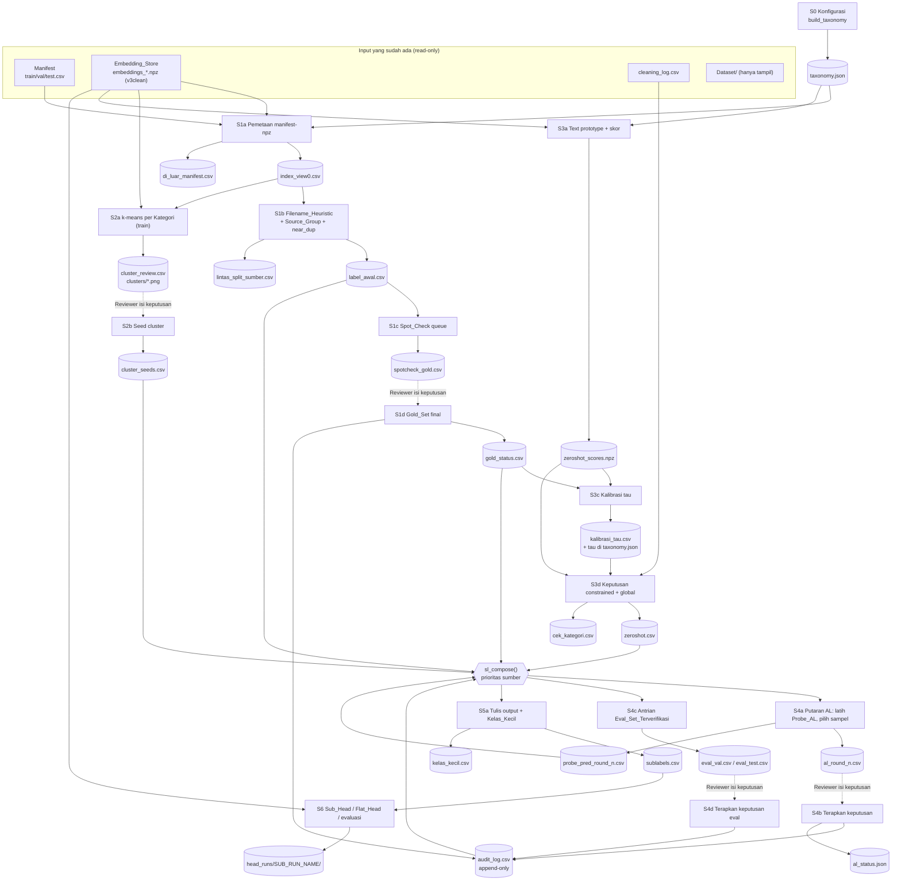
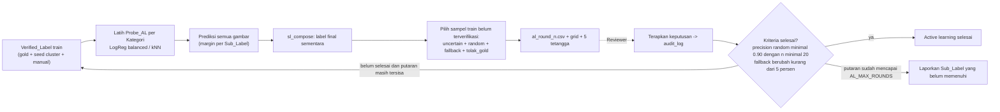
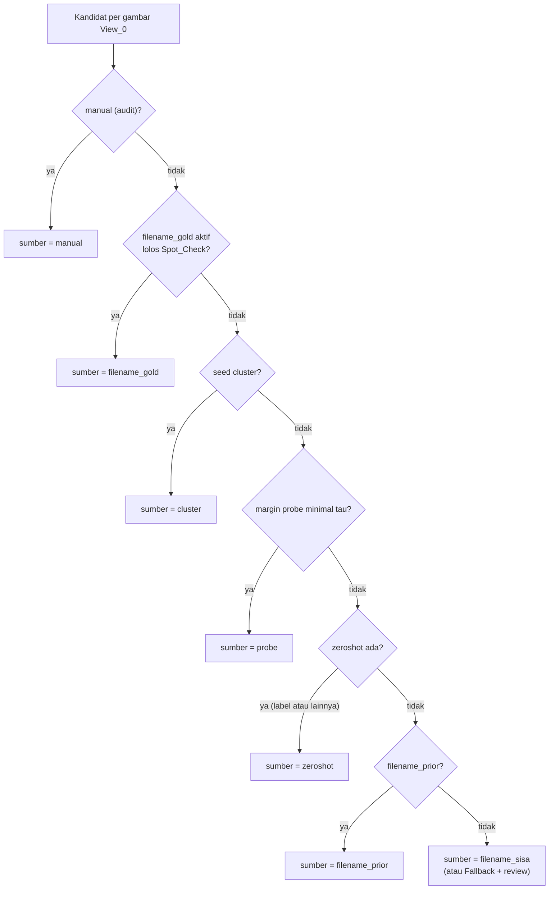

# Design Document: Sub-Label Auto-Labeling (`sublabel-auto-labeling`)

## Overview

Fitur ini menambahkan **label sub-kelas** (13 Sub_Label) di bawah 3 Kategori (`Recylable`, `Organik`, `B3`) supaya fitur panduan daur ulang dapat menampilkan *tindakan konsumen pra-buang* dan *rute penyaluran/pengolahan* yang spesifik. Seluruh komputasi ditambahkan sebagai **bagian baru (Bagian_Sublabel) di `siglip_embedding_probe_colab.ipynb`**, ditempatkan setelah Cell 21 (cell terakhir saat ini, indeks 50 di JSON notebook), dan **memakai ulang** loader, fungsi training head, dan utilitas perbandingan yang sudah ada.

Pendekatan hybrid (B) dari steering `solusi-auto-labeling-siglip.md`, disesuaikan dengan taksonomi final 13 Sub_Label dari user:

1. **Label awal** dari pola nama file (Filename_Heuristic) + Gold_Set + Source_Group (Tahap S1).
2. **Clustering** k-means per Kategori untuk meninjau taksonomi dan memberi seed label (S2).
3. **Zero-shot** memakai text tower `google/siglip-so400m-patch14-384` di atas embedding `.npz` yang sudah ada (tanpa memproses gambar ulang), keputusan constrained + cek kategori global, kalibrasi τ di Gold_Set (S3).
4. **Active learning** dengan verifikasi manusia, plus Eval_Set_Terverifikasi untuk val/test (S4).
5. **Output** `sublabels.csv` + kebijakan Kelas_Kecil (S5).
6. **Sub_Head / Flat_Head** hierarkis, evaluasi, seleksi via val, test disentuh sekali (S6).

### Hasil riset dan temuan yang membentuk desain

**A. Fakta notebook (dibaca langsung dari `siglip_embedding_probe_colab.ipynb`)**

| Hal | Fakta | Dampak desain |
|---|---|---|
| Embedding aktif | `DATA_VERSION='v3clean'`, `EMBEDDING_DIR = ROOT_DIR/embeddings/siglip-so400m-patch14-384_naug_2_2_5_v3clean/` (Cell 2) | Taxonomy_Config menyimpan nama folder ini; steering yang menulis `_naug_2_2_5` perlu diperbarui |
| Isi `.npz` | `embeddings` (float32, 1152-d), `labels`, `label_names`, `paths` (**absolut** saat ekstraksi), `orig_idx`, `view_idx` (`extract_split`, Cell 8) | Pencocokan ke Manifest memakai `_path_key` (dua komponen terakhir path), bukan path penuh |
| `orig_idx` | Indeks baris `df.reset_index(drop=True)` dari `load_manifest(...)` (Cell 5), yaitu manifest **setelah** membuang file yang tidak ada | Pemetaan memakai `load_manifest` yang sama, lalu `assert` kunci path sama (Req 2.2) |
| Val/test | Hanya View_0; train memiliki `1 + N_AUG[label]` view, `N_AUG={'Recylable':2,'Organik':2,'B3':5}` | Label hanya ditetapkan di View_0 lalu disebarkan ke view lain lewat `orig_idx` |
| Global yang diikat 3 kelas | `NUM_CLASSES`, `IDX_TO_LABEL`, `LABEL_TO_IDX`, `cw_tensor`, `X_tr/y_tr/X_va/y_va/X_te/y_te`, `D`, `norm`, `HEAD_DIR`, `results`, `_TEST_REPORTED`, key history `val_recall_B3` | Perlu parameterisasi berkompatibilitas mundur (lihat bagian *Komponen*, §C) |
| Helper di cell yang tidak wajib dijalankan | `std_l2`, `top_neighbors`, `safe_write_csv` (Cell 12b); `knn_probs` (Cell 16); `comparison_table`, `report_test` (Cell 19) | Req 15.2 meminta Bagian_Sublabel jalan setelah Cell 1-12 saja, jadi S0b menyediakan *shim* untuk helper ini |
| Cell 8 | `load_vision_encoder()`, `to_tensor_norm`, `build_aug('val')`, `load_image` | Dipakai untuk uji kesetaraan Req 6.7 (satu-satunya pemakaian vision tower) |
| `cleaning_log.csv` | Kolom `match_key, aksi, label_lama, label_baru, tujuan, status` (66 baris) | `sudah_di_cleaning_log` = `rel_path` ada di `match_key` atau `tujuan` |
| Manifest | `rel_path,label`; 28.965 baris = train 20.275 / val 4.345 / test 4.345 | Dasar hitungan semua Sub_Label (bukan isi folder `Dataset/`) |

**B. Verifikasi Filename_Heuristic terhadap manifest.** Tabel regex di bagian *Data Models* sudah dijalankan terhadap tiga manifest dan **mereproduksi 13 jumlah dari user tepat** (mis. `Aerosol_Elektronik` 1.103, `B3_Rumah_Tangga` 288, `Sisa_Makanan` 12.550, `Sampah_Kebun` 17, `Plastik_Campuran` 222, `Minyak_Jelantah` 14, `Anorganik_Lainnya` 34). Sisa Organik (17) berisi 16 file `R_*` dan 1 `clothes526.jpg`; sisa Recylable (34) berisi 29 `O_*` dan 5 `istockphoto-*`; sisa B3 (288) berisi nama hash + 2 `O_*`.

**C. SigLIP.** SigLIP dilatih dengan *pairwise sigmoid loss*, jadi skor gambar-teks adalah logit independen per pasangan, bukan distribusi softmax ([dokumentasi SigLIP Hugging Face](https://huggingface.co/docs/transformers/v4.46.2/model_doc/siglip)). Karena itu keputusan memakai **Margin softmax antar kandidat** (nilai relatif), bukan ambang sigmoid absolut. Tokenisasi teks memakai `padding="max_length"` karena model dilatih dengan panjang tetap ([panduan padding Transformers](https://huggingface.co/docs/transformers/main/pad_truncation)); padding lain menurunkan kualitas. `logit_scale` dan `logit_bias` ada di `SiglipModel`, bukan di `SiglipVisionModel` yang dimuat Cell 8, sehingga text prototype di-cache bersama kedua skalar itu agar model tidak perlu dimuat ulang (Req 6.5). *(Konten diparafrasekan dari sumber untuk kepatuhan lisensi.)*

**D. Resampling tanpa kebocoran.** `StratifiedGroupKFold` dengan `groups=orig_idx` sudah dipakai di Cell 12b dan dipertahankan ([scikit-learn](https://scikit-learn.org/stable/modules/generated/sklearn.model_selection.StratifiedGroupKFold.html)).

### Keputusan desain utama dan alasannya

| # | Keputusan | Alasan |
|---|---|---|
| D1 | Satu fungsi *entry point* per tahap (`run_s1b()`, `run_s3c()`, ...) yang **hanya membaca file di Output_Dir**, bukan variabel memori | Re-runnable setelah Colab terputus (Req 15.3) |
| D2 | Semua keputusan manusia lewat CSV `keputusan` + `audit_log.csv` yang *append-only*; Verified_Label dibangun ulang dari log | Idempoten (Req 9.10), tidak ada status tersembunyi di memori |
| D3 | `sl_compose()` adalah fungsi murni yang menghitung label final dari file artefak (urutan prioritas Req 11.4) dan dipakai S4a, S4c, S5a | Satu implementasi prioritas, mudah diuji |
| D4 | Hasil zero-shot `lainnya` (Margin < τ) dianggap **keputusan sah** sumber `zeroshot` dan menimpa `filename_prior`, sesuai Req 3.7 dan 11.4. Perbedaan dengan prior ditandai flag `beda_prior` | Sesuai requirement; antrian fallback AL (Req 9.2) hanya bermakna jika `lainnya` memang muncul. Risiko dijelaskan di *Risiko dan Mitigasi* |
| D5 | Parameterisasi fungsi 3-kelas lewat konteks `ctx` dan argumen opsional bernilai default = perilaku lama | Req 13.6/13.7; Cell 13-21 tidak berubah perilakunya |
| D6 | Sub_Head dilatih per Kategori (Recylable 4 kelas, Organik 2 kelas, B3 4 kelas setelah kebijakan Kelas_Kecil); Flat_Head 10 kelas sebagai pembanding | Sesuai taksonomi + kebijakan Kelas_Kecil |
| D7 | Property-based test dijalankan **di dalam notebook** (library `hypothesis`, opsional `RUN_PBT`) terhadap fungsi murni; tidak ada `pytest` suite baru | Repo tidak punya test suite/manifest paket; steering melarang pekerjaan lari-lama dari shell |
| D8 | Semua penulisan file lewat `sl_write_*` yang menolak path di bawah `Dataset/` atau `Archive/` dan menulis atomik (`tmp` lalu `os.replace`) | Req 2.6; aman saat Colab putus |

---

## Architecture

### Posisi di notebook

Bagian_Sublabel adalah **Bagian C** notebook, dimulai dengan satu cell markdown judul (Bahasa Indonesia) setelah Cell 21. Prasyarat: Cell 1-12 sudah dijalankan (Cell 2 menyediakan `ROOT_DIR`, `EMBEDDING_DIR`, `DATA_VERSION`, `MODEL_CHECKPOINT`, `RANDOM_SEED`; Cell 4 `set_seed`; Cell 5 `load_manifest`; Cell 8 `load_vision_encoder`, `to_tensor_norm`; Cell 10 `load_embeddings`; Cell 11 `build_head`, `fit_input_norm`, `apply_input_norm`; Cell 12 `train_head` dan seterusnya). Cell 12b-21 **tidak** diperlukan.

Tiap tahap = satu cell markdown (input, output, keputusan manual yang dibutuhkan; Req 16.4) + satu atau lebih cell kode kecil yang hanya memanggil *entry point*.

| Tahap | Cell | Entry point | Membaca (Output_Dir) | Menulis (Output_Dir) | Gerbang manusia |
|---|---|---|---|---|---|
| S0 | S0a | `build_taxonomy()` | - | `taxonomy.json` | - |
| S0 | S0b | (definisi helper, shim, guard tulis) | - | - | - |
| S1 | S1a | `run_s1a()` | `taxonomy.json`, Manifest, `.npz` | `index_view0.csv`, `di_luar_manifest.csv` | - |
| S1 | S1b | `run_s1b()` | `index_view0.csv`, `taxonomy.json`, `.npz` | `label_awal.csv`, `ringkasan_label_awal.csv`, `lintas_split_sumber.csv`, `cache/train_stats_view0.npz` | - |
| S1 | S1c | `run_s1c()` | `label_awal.csv` | `spotcheck_gold.csv`, `spotcheck_grid/*.png` | Isi `keputusan` |
| S1 | S1d | `run_s1d()` | `spotcheck_gold.csv` | `gold_status.csv`, `spotcheck_precision.csv`, `audit_log.csv` | Menunggu keputusan lengkap |
| S2 | S2a | `run_s2a()` | `index_view0.csv`, `label_awal.csv`, `cache/train_stats_view0.npz`, `.npz` | `cluster_assign.csv`, `clusters/*.png`, `cluster_review.csv` | Isi `keputusan` |
| S2 | S2b | `run_s2b()` | `cluster_review.csv`, `cluster_assign.csv` | `cluster_seeds.csv`, `cluster_usulan.csv` | Menunggu keputusan |
| S3 | S3a | `run_s3a()` | `taxonomy.json`, `.npz` | `cache/text_prototypes_<hash>.npz`, `zeroshot_scores.npz` | - |
| S3 | S3b | `run_s3b()` | `zeroshot_scores.npz` | `zeroshot_equiv_check.json` | - |
| S3 | S3c | `run_s3c()` | `zeroshot_scores.npz`, `gold_status.csv`, `label_awal.csv` | `kalibrasi_tau.csv`, `taxonomy.json` (field τ) | Bergantung S1d |
| S3 | S3d | `run_s3d()` | `zeroshot_scores.npz`, `taxonomy.json` | `zeroshot.csv`, `cek_kategori.csv` | - |
| S4 | S4a | `run_s4a(n)` | semua label sumber + `.npz` | `al_round_<n>.csv`, `al_grid/`, `probe_pred_round_<n>.csv` | Isi `keputusan` |
| S4 | S4b | `run_s4b(n)` | `al_round_<n>.csv` | `audit_log.csv`, `al_status.json` | Menunggu keputusan |
| S4 | S4c | `run_s4c()` | `sl_compose()` | `eval_val.csv`, `eval_test.csv` | Isi `keputusan` |
| S4 | S4d | `run_s4d()` | `eval_val.csv`, `eval_test.csv` | `audit_log.csv` | Menunggu keputusan |
| S5 | S5a | `run_s5a()` | semua artefak S1-S4 | `sublabels.csv`, `ringkasan_sublabel.csv`, `kelas_kecil.csv`, `output_manifest.json` | - |
| S5 | S5b | `validate_outputs()` | `sublabels.csv`, `taxonomy.json` | - (assert) | - |
| S6 | S6a | `run_s6a()` | `sublabels.csv`, `.npz` | `head_runs/<SUB_RUN_NAME>/` (Sub_Head) | - |
| S6 | S6b | `run_s6b()` | idem | `head_runs/<SUB_RUN_NAME>/` (Flat_Head) | - |
| S6 | S6c | `run_s6c()` | hasil S6a/b, kategori head | `perbandingan_subhead_<SUB_RUN_NAME>.csv` | - |
| S6 | S6d | `run_s6d(name)` | model terpilih, `eval_test.csv` | laporan test, `mark_test_use` | Pilih model dari val |

Cell tambahan: **SV-x** (validasi `assert` setelah tahap terkait, Req 15.6) dan **SV-PBT** (opsional, `hypothesis`).

### Diagram alur data dan artefak



### Siklus active learning



### Resolusi label final per gambar



### Batasan Colab T4 dan strategi memori

- Vision tower **tidak** dimuat kecuali di S3b (uji kesetaraan 32 gambar). Text tower dimuat sekali di S3a (fp16, sekitar 2 GB VRAM), lalu `del model; gc.collect(); torch.cuda.empty_cache()` (Req 6.8). Bila cache prototype dengan hash prompt yang sama ada, model tidak dimuat sama sekali.
- Embedding train penuh (sekitar 325 MB float32) dimuat per tahap lalu dilepas. Tahap S1-S5 hanya memakai View_0 lewat `npz_row` di `index_view0.csv`; hanya S6 memuat semua view.
- Skor zero-shot semua gambar: perkalian matriks [28.965 x 1152] x [1152 x 13], di bawah satu detik. k-means (sklearn, `n_init=3`) sekitar 1-2 menit per Kategori di CPU. Probe LogisticRegression beberapa puluh detik per Kategori. Estimasi total S0-S4 di luar review dan unduh model < 10 menit (Req 15.8).
- Semua artefak di `ROOT_DIR` (Drive di Colab), sehingga sesi terputus tidak menghilangkan hasil.


---

## Components and Interfaces

### A. Parameter Bagian_Sublabel (cell S0a)

Semua parameter ada di satu dict `SL_PARAMS` dan disalin ke `taxonomy.json` (`params`). Nama konstanta mengikuti requirement.

```python
TAXONOMY_VERSION   = 'v2'                         # naikkan bila Sub_Label / prompt / pola nama file / teks berubah
SL_DIR             = os.path.join(OUTPUT_DIR, f'sublabel_{TAXONOMY_VERSION}')   # Output_Dir
ARCHIVE_DIR        = os.path.join(ROOT_DIR, 'Archive')
SUB_RUN_NAME       = f'subhead_{TAXONOMY_VERSION}_{DATA_VERSION}_r1'            # ganti tiap eksperimen
SUB_HEAD_DIR       = os.path.join(ROOT_DIR, 'head_runs', SUB_RUN_NAME)

SL_PARAMS = dict(
    SPOTCHECK_N=50, GOLD_MIN_PRECISION=0.95,
    K_CLUSTER={'Recylable': 40, 'Organik': 30, 'B3': 30}, SEED_TOP_N=16,
    TAU_GRID=(0.0, 0.5, 0.01), TARGET_PRECISION=0.90, TAU_DEFAULT=0.10, TAU_GLOBAL_DEFAULT=0.50,
    AL_N_UNCERTAIN=20, AL_N_RANDOM=20, AL_N_FALLBACK=20, AL_MAX_ROUNDS=3,
    AL_MIN_RANDOM_PRECISION=0.90, AL_MIN_RANDOM_N=20, AL_FALLBACK_STABLE=0.05,
    PROBE_TYPE='logreg',            # 'logreg' | 'knn'
    PROBE_USE_ZS_FEATURES=False,
    EVAL_N_PER_SUBLABEL=50, MIN_TRAIN_SUBHEAD=30, MIN_EVAL_SUBLABEL=20,
    NEAR_DUP_COS=NEAR_DUP_COS,      # dari Cell 2 (0.97)
    SUB_HEADS_TO_COMPARE=['linear', 'mlp', 'mlp2'],
    SEED=RANDOM_SEED,
)
```

### B. Helper bersama (cell S0b)

Semua fungsi `sl_*` di bawah didefinisikan di S0b. Fungsi bertanda **murni** tidak menyentuh disk/GPU dan menjadi target property-based test.

| Fungsi | Murni | Tugas | Req |
|---|---|---|---|
| `class SublabelError(RuntimeError)` | - | Galat yang menghentikan eksekusi dengan pesan jelas | 1.6, 2.2, 6.2, 12.5, 15.4 |
| `validate_taxonomy(cfg)` | ya | Cek nama unik, Kategori valid, >= 2 prompt, tindakan/rute tidak kosong dan bukan placeholder, `merge` valid, `urutan_heuristik` lengkap | 1.6, 12.5 |
| `taxonomy_hash(cfg)` | ya | SHA-256 atas JSON kanonik bagian yang menentukan versi (nama, Kategori, prompt, pola, teks, urutan) | 1.8 |
| `prompt_hash(cfg)` | ya | Hash khusus prompt (kunci cache prototype); tidak bergantung urutan kunci dict | 6.5 |
| `sl_write_taxonomy(cfg, path)` / `sl_read_taxonomy(path)` | tidak | Tulis/baca JSON (`ensure_ascii=False`, `sort_keys=False`); round-trip identik | 1.5 |
| `sl_guard_write(path)` | ya | Izinkan hanya di bawah `SL_DIR` atau `SUB_HEAD_DIR`; tolak di bawah `DATASET_DIR`/`ARCHIVE_DIR` atau di luar akar yang diizinkan | 2.6 |
| `sl_atomic_write_csv(df, path)` | tidak | Lewat `sl_guard_write`, tulis ke `*.tmp` lalu `os.replace` | 2.6, 15.3 |
| `sl_write_csv_reviewsafe(df, path)` | tidak | Bila file lama punya kolom `keputusan` terisi, tulis ke `*_baru.csv`, file lama tidak disentuh (generalisasi `safe_write_csv` Cell 12b yang hard-code `DIAG_DIR`) | 4.8 |
| `sl_require(files, hint)` | tidak | Jika ada file hilang, `SublabelError` menyebut file dan tahap yang harus dijalankan | 15.4 |
| `sl_gate_queue(path, nama)` | tidak | Baca Review_Queue; bila ada `keputusan` kosong cetak instruksi + jumlah belum diputuskan dan kembalikan `None` (tahap dilewati) | 15.5 |
| `sl_path_key(p)` | ya | Alias `_path_key` Cell 12 (dua komponen terakhir, separator `\` dan `/`) | 2.2, 2.7 |
| `sl_source_group(filename)` | ya | Bagian nama file sebelum `.rf.`; tanpa `.rf.` = nama file itu sendiri | 4.6 |
| `sl_classify_filename(kategori, filename, tax)` | ya | Kembalikan `(sub_label, sumber, rule_id)` dengan urutan prioritas `urutan_heuristik` | 3.1-3.3, 3.6, 3.8 |
| `sl_softmax_masked(scores, mask)` | ya | Softmax di antara kolom `mask` per baris (kolom lain dapat 0) | 7.1 |
| `sl_decide_constrained(scores, cat_cols, tau)` | ya | Top-1, confidence, margin; `lainnya` bila margin < tau | 7.1-7.5 |
| `sl_decide_global(scores, own_cat_cols, sub_cat, tau_g)` | ya | Argmax 13 arah, `margin_global`, flag `cek_kategori` | 7.6, 7.7 |
| `sl_proto(vectors)` | ya | `normalize(mean(normalize(v)))` | 6.4 |
| `sl_calibrate_tau(margin, top1, gold, grid, target)` | ya | Pilih τ (lihat S3c); kembalikan `(tau, precision, coverage, status)` | 8.1-8.4 |
| `sl_resolve(cands)` | ya | Pilih satu kandidat menurut `SUMBER_PRIORITAS` | 11.4 |
| `sl_propagate(row_orig_idx, label_by_orig)` | ya | Label tiap baris view = label View_0 dengan `orig_idx` sama | 11.2, 11.3 |
| `sl_rebuild_verified(audit_df, gold_status, cluster_seeds)` | ya | Verified_Label deterministik dari log (keputusan terakhir menang) | 9.10 |
| `sl_scores(E, T, a, b)` | ya | `a * normalize(E) @ T.T + b` | 6.6 |
| `sl_gold_status(spotcheck_df, params)` | ya | Precision Spot_Check, status `aktif` / `ditolak` / `sublabel_diturunkan` | 4.3-4.5 |
| `sl_select_seeds(dist, cluster_decisions, top_n)` | ya | Pilih seed dari jarak ke centroid (train saja) | 5.4, 5.6 |
| `sl_select_al(pool, params, rng)` | ya | Bucket `uncertain` / `random` / `fallback` / `tolak_gold` | 9.2 |
| `sl_al_precision(decisions)` / `sl_al_done(status, params)` | ya | Precision dari baris `random` saja; kriteria selesai AL | 9.5-9.8 |
| `sl_build_eval_queue(tab, split, params, rng)` | ya | Strata + Kelas_Kecil menurut jumlah anggota, tanpa gold aktif | 10.1, 10.2 |
| `sl_output_classes(scope, cfg)` / `sl_train_rows(tab, cfg, scope)` | ya | Kelas output setelah kebijakan; baris training layak dengan pemetaan `merge` | 12.2, 12.3, 13.3 |
| `sl_route_hier(prob_kat, probs_sub, mode, y_true_kat)` | ya | Perutean `oracle` / `end_to_end` | 14.1 |
| `sl_sort_comparison(df)` / `sl_b3_turun(recall_flat, recall_base)` | ya | Urutan tabel dan tanda `B3_turun` | 14.3, 14.4 |
| `write_sublabel_table(df, path)` / `read_sublabel_table(path)` | tidak | CSV dengan `dtype` eksplisit dan `keep_default_na=False` pada kolom string | 11.7 |
| `sl_assert_group_folds(folds, groups)` | ya | Gagal bila satu `orig_idx` ada di dua fold | 13.9 |
| `sl_audit_append(rows)` | tidak | Tambah baris ke `audit_log.csv` tanpa mengubah baris lama; lewati baris identik yang sudah menjadi keputusan terakhir | 9.11 |
| `sl_compose(round=None)` | tidak (baca file) | Hitung Sublabel_Table dari artefak | 11.1, 11.4-11.6 |
| `sl_kelas_kecil(n_train_ver, n_val_ver, cfg)` | ya | Tandai Kelas_Kecil dan terapkan kebijakan | 12.1-12.5 |
| `sl_class_weights(counts)` | ya | `N / (C x N_c)` | 13.4 |
| `sl_macro_f1_reliable(y, p, names, min_n)` | ya | Macro F1 hanya atas kelas dengan `n_eval >= min_n`; kembalikan flag `tidak_reliabel` | 10.5, 10.6 |
| `sl_sample_queue(pool, n, rng)` | ya | `min(n, len(pool))` baris acak, urut deterministik (`sorted(path)` sebelum sampling) | 4.2, 9.2, 10.1 |
| `sl_grid(paths, titles, out_png, ncols, thumb=160)` | tidak | Grid thumbnail dari `Dataset/` (hanya baca) | 4.2, 5.2, 9.3 |
| `sl_load_view0(split)` | tidak | `(Z_raw [N,1152], idx_df)` untuk View_0 via `npz_row` | 2.1 |
| `sl_train_stats()` | tidak | `mu, sd` dari train View_0, di-cache di `cache/train_stats_view0.npz` | 5.1 |
| `sl_std_l2(X, mu, sd)` | ya | Standardize lalu L2 (versi eksplisit dari `std_l2` Cell 12b, tanpa argumen default terikat global) | 5.1 |
| shim `top_neighbors` | tidak | `if 'top_neighbors' not in globals():` definisikan salinan identik dari Cell 12b | 15.2 |

**Shim, bukan refactor.** `std_l2`, `top_neighbors`, `safe_write_csv` (Cell 12b) dan `knn_probs` (Cell 16) berada di cell yang tidak wajib dijalankan. Daripada memindahkan kode lama (berisiko mengubah Cell 12b/16), S0b mendefinisikan `top_neighbors` dengan guard `if not in globals()`, dan fungsi baru `sl_std_l2` / `sl_write_csv_reviewsafe` sebagai pengganti. `knn_probs` diparameterkan (§C) dan salinannya dipindahkan ke S0b dengan guard yang sama; bila Cell 16 dijalankan belakangan, definisinya identik secara perilaku.

`SUMBER_PRIORITAS = ['manual', 'filename_gold', 'cluster', 'probe', 'zeroshot', 'filename_prior', 'filename_sisa']`

`FLAG_TOKENS = {'review', 'cek_kategori', 'kelas_kecil', 'lintas_split_sumber', 'near_dup', 'tolak_gold', 'beda_prior'}`. Kolom `flag` berisi token dipisah `;` dan diurutkan alfabetis (determinisme), string kosong bila tidak ada.

### C. Parameterisasi fungsi 3-kelas (berkompatibilitas mundur)

Fungsi yang dipakai ulang untuk Sub_Head ditambahi **argumen opsional**; nilai default `None` berarti "pakai global 3-kelas seperti sebelumnya". Pemanggilan lama (Cell 13, 16, 18, 19, 20) tidak berubah.

| Fungsi (cell) | Terikat ke | Perubahan (semua opsional) |
|---|---|---|
| `make_criterion` (11) | `cw_tensor` | `make_criterion(weight=None)`; `None` -> `cw_tensor` yang dibaca saat dipanggil |
| `metrics_from_preds` (12) | `NUM_CLASSES`, `IDX_TO_LABEL` | `(y_true, y_pred, num_classes=None, idx_to_label=None)` |
| `evaluate_head` (12) | idem | tambah `num_classes=None, idx_to_label=None`, diteruskan ke `metrics_from_preds` |
| `head_paths` (12) | `HEAD_DIR` | `head_paths(run_name, head_dir=None)` |
| `save_head` (12) | `D`, `NUM_CLASSES`, `norm`, `LABEL_TO_IDX` | `save_head(model, path, head_type, ctx=None)` |
| `train_head` (12) | `X_tr,y_tr,X_va,y_va,D,NUM_CLASSES`, key `val_recall_B3` | `train_head(head_type, run_name, seed=None, verbose=True, ctx=None)` |
| `register_result`, `register_neural` (12) | `results`, `y_va`, `X_va`, `X_te` | tambah `registry=None, y_val=None, num_classes=None, idx_to_label=None`; `register_neural(..., X_val=None, X_test=None)` (jika `X_test is None` probabilitas test **tidak** dihitung) |
| `mark_test_use` (12) | `_TEST_REPORTED` | `mark_test_use(name, tracker=None)`; Sub_Head memakai `_SUB_TEST_REPORTED` agar tidak memicu peringatan palsu karena test sudah dipakai model 3-kelas (Req 14.6 hanya peduli model sub-label lain) |
| `knn_probs` (16) | `NUM_CLASSES` | tambah `num_classes=None` |

`train_one_epoch_head`, `predict_proba`, `build_head`, `fit_input_norm`, `apply_input_norm`, `load_head` sudah generik dan tidak diubah.

**Konteks training `ctx`** (dict; satu Kategori = satu `ctx`):

```python
def _default_ctx():                      # dibangun saat dipanggil -> mengikuti global terbaru
    return dict(X_tr=X_tr, y_tr=y_tr, X_va=X_va, y_va=y_va, in_dim=D,
                num_classes=NUM_CLASSES, idx_to_label=IDX_TO_LABEL, label_to_idx=LABEL_TO_IDX,
                class_weight=cw_tensor, head_dir=HEAD_DIR, norm=norm)

def train_head(head_type, run_name, seed=None, verbose=True, ctx=None):
    ctx = ctx or _default_ctx()
    model     = build_head(head_type, ctx['in_dim'], ctx['num_classes'], DROPOUT_RATE, HEAD_ACT).to(device)
    criterion = make_criterion(weight=ctx['class_weight'])
    hist_path, best_path = head_paths(run_name, ctx['head_dir'])
    names = list(ctx['idx_to_label'].values())
    history = {'train_loss': [], 'train_acc': [], 'val_loss': [], 'val_acc': [],
               **{f'val_{m}_{n}': [] for n in names for m in ('recall', 'precision', 'f1')}}
    # ... loop identik; evaluate_head(..., num_classes=ctx['num_classes'], idx_to_label=ctx['idx_to_label'])
    # save_head(model, best_path, head_type, ctx)
```

Untuk ctx default, `history` adalah **superset** key lama (`val_recall_B3`, `val_precision_B3`, `val_f1_B3`, `val_recall_Recylable`, `val_recall_Organik` tetap ada), jadi Cell 14 (plot) tetap bekerja. Baris log `verbose` memakai format lama bila `ctx` default.

**Uji regresi (Req 13.6/13.7):** sel SV-regresi menjalankan `train_head('mlp', RUN_NAME+'__regresi', verbose=False)` dengan `HEAD_EPOCHS` sementara 3 dan seed tetap, lalu membandingkan `train_loss`/`val_loss` 3 epoch pertama terhadap `history_<RUN_NAME>.json` lama (toleransi 1e-3, karena `cudnn.deterministic=True`) serta `metrics_from_preds(y, p) == metrics_from_preds(y, p, 3, IDX_TO_LABEL)`.

### D. Desain per tahap

#### S0 - Konfigurasi dan Taxonomy_Config

- **S0a** berisi satu dict Python `TAXONOMY_SPEC` (13 Sub_Label + 3 entri `lainnya`) dan `SL_PARAMS`. `build_taxonomy()` memanggil `validate_taxonomy`, menghitung `content_hash`, lalu menulis `taxonomy.json`.
- Jika `taxonomy.json` sudah ada di `SL_DIR` dan `content_hash` berbeda dari spec di cell, `build_taxonomy()` berhenti dengan pesan "naikkan `TAXONOMY_VERSION`" dan **tidak menimpa** versi lama (Req 1.8). Jika hash sama, field τ dan status hasil kalibrasi di file dipertahankan.
- Teks `tindakan_konsumen_pra_buang` dan `rute_penyaluran_pengolahan` ditempel **verbatim dari tabel user** (belum ada di repo; lihat *Risiko*). `validate_taxonomy` menolak teks kosong atau yang masih berisi placeholder `<<ISI DARI USER>>`.
- Penambahan Sub_Label baru cukup mengubah `TAXONOMY_SPEC`; tahap lain membaca `taxonomy.json` dan tidak memuat nama Sub_Label hard-coded (Req 1.7).

#### S1 - Cakupan data, label awal, Gold_Set, Source_Group

**S1a (`run_s1a`)** memetakan View_0 ke Manifest:

1. Untuk tiap split: `df = load_manifest(CSV, DATASET_DIR)` (fungsi Cell 5, sehingga indeks identik dengan saat ekstraksi); `assert DEBUG_MAX_PER_CLASS is None`.
2. `d = load_embeddings(split)`; `rows0 = np.where(d['view_idx'] == 0)[0]`; `assert` `orig_idx[rows0]` unik dan sama dengan `range(len(df))`.
3. `assert` `sl_path_key(d['paths'][r]) == sl_path_key(df.rel_path[orig_idx[r]])` untuk setiap baris; bila ada selisih, `SublabelError` menyebut 5 contoh pertama (Req 2.2). `kategori` dari kolom `label` manifest, diverifikasi sama dengan `label_names`.
4. Tulis `index_view0.csv` (`split, orig_idx, npz_row, path, kategori, source_group`) dan `di_luar_manifest.csv` (daftar gambar di `Dataset/{0_Recylable,1_Organik,2_B3}` yang `rel_path`-nya tidak ada di Manifest; `duplicates_removed/` dilewati; hanya `os.scandir`, tidak mengubah apa pun). Untuk manifest v3clean diharapkan 169 baris di `2_B3`.
5. Assert total baris `index_view0.csv` = 28.965 dan (`split`,`orig_idx`) unik (Req 2.4).

**S1b (`run_s1b`)**:

- Label awal: `sl_classify_filename` pada `basename(rel_path)`; tabel regex ada di *Data Models*. Hasil `label_awal.csv`.
- Tabel Kategori x Sub_Label x jumlah dibandingkan dengan `jumlah_sampel_user` di Taxonomy_Config; selisih dicetak sebagai peringatan (Req 3.4, 3.5), eksekusi lanjut. `ringkasan_label_awal.csv` menyimpan tabelnya.
- `source_group` per gambar; `lintas_split_sumber.csv` berisi grup yang anggotanya ada di > 1 split.
- Flag `lintas_split_sumber` untuk gambar val/test yang `source_group`-nya juga ada di train (Req 4.7).
- Flag `near_dup`: untuk pasangan (val,train), (test,train), (test,val) hitung `top_neighbors(Z_q, Z_db, k=1)` pada `sl_std_l2` View_0 dengan statistik train; `cos >= NEAR_DUP_COS` -> `near_dup` pada gambar query. Kedua flag membentuk mask `_nodup` di S6.

**S1c (`run_s1c`)** membuat `spotcheck_gold.csv`: untuk tiap Sub_Label bersumber `filename_gold`, `sl_sample_queue(pool, min(SPOTCHECK_N, n), rng=default_rng(SEED))` dari **semua split** (kualitas gold adalah sifat pola nama file, jadi sampel tidak distratifikasi per split), grid `spotcheck_grid/<sub_label>.png` bernomor (kolom `no` = nomor sel).

**S1d (`run_s1d`)** membaca keputusan (gerbang: semua baris terisi):

- precision Spot_Check per Sub_Label = `n(keputusan=='ok') / n(baris)`.
- precision < `GOLD_MIN_PRECISION` -> seluruh anggota Sub_Label itu `status='sublabel_diturunkan'` (label kembali `filename_prior`).
- Baris dengan keputusan selain `ok` -> `status='ditolak'`, flag `tolak_gold`, dan masuk wajib ke antrian AL berikutnya (`asal_pilihan='tolak_gold'`). Bila keputusan berupa Sub_Label lain atau `lainnya`, label itu menjadi keputusan manual (verified).
- Semua keputusan ditambahkan ke `audit_log.csv` (`tahap='spotcheck'`).
- Output `gold_status.csv` (`path, orig_idx, split, kategori, sub_label_gold, status in {aktif, ditolak, sublabel_diturunkan}`) dan `spotcheck_precision.csv`.

#### S2 - Clustering

**S2a**: per Kategori ambil View_0 train, `Z = sl_std_l2(E, mu, sd)`, `k = min(K_CLUSTER[kat], n // 20)`, `KMeans(n_clusters=k, n_init=3, random_state=SEED)`. Untuk tiap cluster urutkan anggota menurut jarak ke centroid (`dist_rank` 1..n); grid 4x4 `clusters/<kat>_c<id>.png` berisi 16 terdekat. `cluster_review.csv` berisi distribusi `Sub_Label` awal per cluster sebagai teks `Nama:jumlah;...`.

**S2b**: validasi nilai `keputusan` (Sub_Label milik Kategori itu, `campuran`, atau `usul:<nama>`; nilai lain -> `SublabelError`). Untuk cluster bernama Sub_Label, hanya anggota dengan `dist_rank <= SEED_TOP_N` yang menjadi seed (`sumber='cluster'`, ini persis 16 gambar yang tampil di grid sehingga Reviewer memang melihat semuanya). `usul:*` hanya dicetak dan ditulis ke `cluster_usulan.csv`; `taxonomy.json` tidak diubah. Hanya split train yang dipakai (Req 5.6).

#### S3 - Zero-shot, cek kategori, kalibrasi τ

**S3a (`run_s3a`)**

```python
# Prototype per Sub_Label (Req 6.3, 6.4): padding="max_length" dan rata-rata embedding ternormalisasi
def encode_text(prompts):
    inp = proc(text=prompts, padding='max_length', return_tensors='pt').to(device)
    return F.normalize(model.get_text_features(**inp).float(), dim=-1)
proto[k] = F.normalize(encode_text(prompts[k]).mean(0), dim=-1)
```

- Cek checkpoint (Req 6.2): `taxonomy.model_checkpoint == MODEL_CHECKPOINT` dan `os.path.basename(EMBEDDING_DIR)` diawali `MODEL_CHECKPOINT.split('/')[-1]`; selain itu `SublabelError` menyebut kedua nama.
- Cache `cache/text_prototypes_<prompt_hash>.npz` menyimpan `protos [13,1152]`, `sub_labels`, `logit_scale` (nilai `exp`), `logit_bias`. Bila cache ada, `AutoModel`/`AutoProcessor` **tidak** dimuat. Bila tidak: `AutoModel.from_pretrained(MODEL_CHECKPOINT, torch_dtype=torch.float16).to(device).eval()`, hitung, simpan cache, lalu bebaskan GPU (Req 6.8).
- Skor semua View_0 (Req 6.6): `scores = a * normalize(E) @ protos.T + b`, disimpan di `zeroshot_scores.npz` (`scores float32 [N,13]`, `sub_labels`, `split`, `orig_idx`, `path`, `a`, `b`, `prompt_hash`) dengan urutan sama dengan `index_view0.csv`.

**S3b (`run_s3b`)** uji kesetaraan Req 6.7: 32 View_0 train acak (seed tetap) di-encode ulang dengan `load_vision_encoder()` + `load_image` + `build_aug('val')` + `to_tensor_norm`, skor dibandingkan dengan `zeroshot_scores.npz`; `max |selisih| <= 1e-2` atau `SublabelError`. Hasil di `zeroshot_equiv_check.json`; vision tower dibebaskan sesudahnya. Catatan: `a = exp(logit_scale)` mengalikan galat fp16 embedding; jika selisih sedikit di atas 1e-2, ulangi dengan `USE_FP16=False` untuk menentukan apakah penyebabnya presisi.

**S3c (`run_s3c`)** kalibrasi τ per Kategori. Hanya berjalan jika `gold_status.csv` ada (S1d selesai); bila belum, τ tetap `TAU_DEFAULT` dengan `status='default'` dan hasil S3d diberi catatan "belum dikalibrasi".

- Himpunan kalibrasi: gambar **train** dengan `status=='aktif'` pada Kategori itu.
- Per gambar: `margin` constrained dan `top1`; `benar = (top1 == sub_label_gold)`.
- Metrik `prec(tau)` = rata-rata makro atas Sub_Label gold `g` dari `n(margin>=tau & benar & gold==g) / n(margin>=tau & gold==g)` (Sub_Label tanpa gambar diterima dilewati). Dipilih karena Gold_Set hanya punya positif untuk sebagian Sub_Label, jadi precision per Sub_Label prediksi tidak terdefinisi untuk Sub_Label non-gold; makro mencegah Tekstil (sekitar 1.800 gambar train) mendominasi Kategori Recylable. `coverage(tau) = n(margin>=tau) / n`.
- Grid `tau in {0.00, 0.01, ..., 0.50}`; pilih **τ terkecil** dengan `prec >= TARGET_PRECISION` (Req 8.2). Jika tidak ada: pilih τ dengan `prec` tertinggi (imbang -> τ terkecil), `status='presisi_tidak_tercapai'` dan alasan disimpan (Req 8.3).
- Jika Gold_Set Kategori hanya mencakup satu Sub_Label (Organik: `Limbah_Biologis`): `status='perlu_kalibrasi_ulang'` + peringatan bias (Req 8.4). Kolom `cakupan_gold` (jumlah Sub_Label gold / jumlah Sub_Label Kategori) dicatat untuk semua Kategori.
- Evaluasi Gold_Set **val**: precision/recall/F1 per Sub_Label dan confusion matrix (`lainnya` dihitung sebagai prediksi tersendiri), disimpan `zeroshot_gold_val.csv` (Req 8.5). Test Gold_Set tidak disentuh (Req 8.7).
- Tulis `kalibrasi_tau.csv` (seluruh grid: `kategori, tau, precision, coverage, n_diterima, dipilih`) dan perbarui field τ di `taxonomy.json` secara atomik.

**S3d (`run_s3d`)**: dari `zeroshot_scores.npz` + τ:

- Constrained (Req 7.1-7.3): `softmax` hanya atas kolom Sub_Label Kategori gambar; `confidence = p1`, `margin = p1 - p2`; `margin < tau[kat]` -> `zs_sub_label='lainnya'` dan `zs_flag_review=True`.
- Global (Req 7.6, 7.7): softmax atas 13 kolom; `k*` = argmax; bila `kategori(k*) != kategori gambar` dan `margin_global >= tau_global` -> `flag_cek_kategori`, di mana `margin_global = p_global[k*] - max_{k in Kategori gambar} p_global[k]`.
- Output `zeroshot.csv` dan `cek_kategori.csv`. Urutan `cek_kategori.csv`: baris yang melibatkan B3 (kategori asli atau `kategori_global`) lebih dulu, lalu `margin_global` menurun (Req 7.9). Kolom `sudah_di_cleaning_log` = `rel_path` ∈ {`match_key`} ∪ {`tujuan`} dari `cleaning_log.csv` (Req 7.8). Nilai `keputusan` yang diizinkan: `tetap`, `pindah:<Kategori>`, `buang`. **Tidak ada perubahan Kategori di notebook ini**; perbaikan dilakukan di `preprocessing_lokal.ipynb` lalu re-ekstraksi ke `EMBEDDING_DIR` baru (Req 7.10).

#### S4 - Active learning dan Eval_Set_Terverifikasi

**Verified_Label** (dibangun ulang tiap pemanggilan oleh `sl_rebuild_verified`): (a) `filename_gold` dengan `status=='aktif'`; (b) seed cluster; (c) keputusan manual terakhir per `path` dari `audit_log.csv` (nilai `ok` mengonfirmasi `sub_label_sebelum`). Keputusan `cek_kategori` mengeluarkan gambar dari semua himpunan Verified, training, dan evaluasi sampai Kategori diperbaiki di preprocessing.

**S4a (`run_s4a(n)`)**:

1. Probe per Kategori hanya dari Verified train View_0 non-fallback. Kategori dengan < 2 kelas terverifikasi dilewati (dicetak); tidak ada Pseudo_Label yang masuk sebagai target (Req 9.9).
2. `PROBE_TYPE='logreg'`: `LogisticRegression(class_weight='balanced', max_iter=1000)` pada `sl_std_l2`; `'knn'`: `knn_probs(..., num_classes=C)` cosine. Fitur opsional: skor zero-shot ternormalisasi (`PROBE_USE_ZS_FEATURES`).
3. Prediksi seluruh View_0 (semua split) -> `probe_pred_round_<n>.csv` (`probe_sub_label, probe_conf, probe_margin`). Sumber `probe` dipakai `sl_compose` hanya bila `probe_margin >= tau[kat]` (Probe tidak punya kelas `lainnya`; margin rendah = abstain).
4. `sl_compose(round=n)` menghasilkan label sementara; `fallback_count_n` = jumlah gambar train berlabel `lainnya`.
5. Pool = gambar train yang bukan Verified dan tidak `cek_kategori`. Per (Kategori, Sub_Label sementara): `AL_N_UNCERTAIN` margin terendah (margin `NaN` diurutkan paling akhir), lalu `AL_N_RANDOM` acak dari pool dikurangi yang sudah terpilih, lalu per Kategori `AL_N_FALLBACK` acak dari label `lainnya`, ditambah semua `tolak_gold` (wajib). Sebuah gambar hanya muncul sekali (prioritas `tolak_gold` > `uncertain` > `random` > `fallback`).
6. `al_round_<n>.csv` + grid `al_grid/r<n>_<kat>_<sub>_p<k>.png`: tiap baris grid = [gambar | 5 tetangga Verified terdekat] dengan judul Sub_Label prediksi. Grid dibuat per Kategori sesuai argumen supaya pembacaan Drive tidak berat.

**S4b (`run_s4b(n)`)**: gerbang keputusan; nilai valid `ok`, nama Sub_Label Kategori itu, `lainnya`, `cek_kategori`. Tambahkan ke `audit_log.csv`. Hitung per Sub_Label: `precision_random = n_ok / n_diputuskan` hanya dari baris `asal_pilihan=='random'` dengan `sub_label_sebelum == k` (Req 9.5). `al_status.json` menyimpan per putaran `precision_random`, `n_random`, `fallback_count`. Selesai bila untuk semua Sub_Label non-Kelas_Kecil: `precision_random >= 0.90` dengan `n_random >= 20`, dan `|fallback_n - fallback_(n-1)| / fallback_(n-1) < 0.05` (butuh >= 2 putaran). Jika `n == AL_MAX_ROUNDS` tanpa terpenuhi, cetak Sub_Label yang gagal beserta precision terakhir (Req 9.8).

**S4c (`run_s4c`)** membuat `eval_val.csv` dan `eval_test.csv` dari `sl_compose()` terakhir:

- Strata = (Kategori, Sub_Label termasuk `lainnya`) per split. Target `EVAL_N_PER_SUBLABEL` total gambar terverifikasi per strata: anggota yang sudah terverifikasi (mis. gold lolos Spot_Check, Req 10.2) dihitung dulu, kekurangannya diambil acak dari anggota belum terverifikasi (`min(kekurangan, jumlah)`).
- Ditambah **semua anggota** strata yang termasuk Kelas_Kecil menurut *jumlah anggota* (`< MIN_EVAL_SUBLABEL` di split itu atau `< MIN_TRAIN_SUBHEAD` di train). Memakai jumlah anggota, bukan jumlah Verified, karena sebelum evaluasi dilakukan jumlah Verified val hampir nol untuk semua Sub_Label non-gold dan semuanya akan tampak "kecil".
- `keputusan` valid sama dengan S4b. Val/test **tidak** pernah masuk training Probe atau Sub_Head (Req 10.4).

**S4d (`run_s4d`)** menambah keputusan ke `audit_log.csv` (`tahap='eval_val'|'eval_test'`).

#### S5 - Output dan Kelas_Kecil

**S5a (`run_s5a`)**: `sl_compose()` -> `sublabels.csv` (11 kolom). Kelas_Kecil dihitung dari jumlah Verified (Req 12.1) -> `kelas_kecil.csv` dan flag `kelas_kecil`. Kebijakan:

| Sub_Label | Kebijakan | Efek |
|---|---|---|
| `Minyak_Jelantah` | `rule_only` | Bukan kelas output Sub_Head; baris training-nya dibuang dari Sub_Head Recylable |
| `Sampah_Kebun` | `merge:Sisa_Makanan` | Target training = `Sisa_Makanan`; label asli tetap di `sublabels.csv` |
| `Anorganik_Lainnya` | `merge:Plastik_Kemasan` | Target training = `Plastik_Kemasan` |
| lainnya | `latih` (default) | Dilatih; bila Kelas_Kecil, metrik ditandai `tidak_reliabel` |

Ringkasan Kategori x Sub_Label x split x `sumber`, jumlah `lainnya`, dan jumlah per flag dicetak dan disimpan `ringkasan_sublabel.csv` (Req 11.9). `output_manifest.json` mendaftar 7 file wajib Req 11.8 beserta jumlah barisnya.

**S5b (`validate_outputs`)** + sel SV: assert Req 2.4, 3.8, 7.4, 7.5, 11.3, 11.6, 11.7 (lihat *Testing Strategy*).

#### S6 - Sub_Head, Flat_Head, evaluasi

**Kelas output**: `sl_output_classes(scope)`: Sub_Label Kategori tersebut dikurangi `rule_only`, dikurangi yang di-`merge` (digantikan targetnya), urut alfabetis. Dengan konfigurasi saat ini: Recylable {`Kertas_Karton`, `Plastik_Campuran`, `Plastik_Kemasan`, `Tekstil`}, Organik {`Limbah_Biologis`, `Sisa_Makanan`}, B3 {`Aerosol_Elektronik`, `B3_Rumah_Tangga`, `Baterai`, `Medis_Farmasi`}; Flat = gabungan 10 kelas. Kategori dengan satu kelas output ditetapkan langsung tanpa training (Req 13.2).

**S6a (`run_s6a`)** per Kategori (`scope`):

1. Muat `.npz` train penuh (semua view). Label View_0 dari `sublabels.csv`; `sl_propagate` ke semua view lewat `orig_idx` (Req 11.2).
2. Baris train layak (Req 13.3): label final non-`lainnya`, bukan `cek_kategori`, dan (`terverifikasi` **atau** `sumber in {zeroshot, probe}` dengan `margin >= tau[kat]`); `filename_prior/sisa` tanpa margin tidak dipakai. Terapkan kebijakan (`rule_only` dibuang, `merge` dipetakan). Catat proporsi Verified vs Pseudo per kelas ke `run_config` (Req 13.3).
3. `norm = fit_input_norm(X_train_kategori, INPUT_NORM)` (statistik train Kategori itu); `class_weight = sl_class_weights(bincount(y_tr))` dari **baris** termasuk view augmentasi (Req 13.4).
4. Val = View_0 val `terverifikasi` dengan label ∈ kelas output Kategori itu (Eval_Set_Terverifikasi). Test tidak dimuat di tahap ini.
5. Untuk `ht in SUB_HEADS_TO_COMPARE` panggil `train_head(ht, f'{SUB_RUN_NAME}__{scope}__{ht}', seed, verbose=False, ctx=ctx)` -> early stopping val loss, `history_*.json` dengan recall/precision/F1 per Sub_Label per epoch (Req 13.5), `run_config_*.json`. Kemudian kNN cosine (`knn_probs(..., num_classes=C)`, k=`KNN_K`, temp=`KNN_TEMP`, vote x class weight).
6. `register_result(f'{scope}::{ht}', ..., registry=SUB_REGISTRY, y_val=..., num_classes=C, idx_to_label=...)`. Probabilitas disimpan untuk **seluruh val** (4.345 baris) supaya mode `end_to_end` dapat merutekan gambar ke Sub_Head Kategori hasil prediksi. Probabilitas test **tidak** dihitung (Req 8.7, 14.6).
7. `SUB_HEAD_DIR` yang sudah berisi `history_*` memicu peringatan ganti `SUB_RUN_NAME` (Req 13.8); `os.makedirs` baru dipanggil setelah pengecekan.

**S6b (`run_s6b`)**: Flat_Head 10 kelas dengan konfigurasi identik (`scope='flat'`, norm dan class weight dari seluruh baris train layak), jenis head sama dengan S6a (Req 13.11, 13.12).

**S6c (`run_s6c`)** evaluasi val, tiga mode:

| Mode | Perutean Kategori | Gambar yang dinilai |
|---|---|---|
| `hier_oracle::<h>` | Kategori sebenarnya (dari Manifest) | Eval_Set_Terverifikasi val, label ∈ 10 kelas |
| `hier_e2e::<h>` | Kategori prediksi head 3-kelas terpilih | idem; bila kelas sebenarnya tidak ada di Sub_Head Kategori prediksi, dihitung salah |
| `flat::<h>` | Kategori diturunkan dari kelas prediksi Flat_Head | idem |

`<h>` ∈ `SUB_HEADS_TO_COMPARE` ∪ {`knn`} ∪ {`best_per_kategori`} (head terbaik per Kategori menurut macro F1 val Kategori itu). Sumber Kategori untuk `hier_e2e`: (1) `results[FINAL_MODEL]` bila ada di memori; (2) `kategori_pred_val_<SUB_RUN_NAME>.csv` yang di-cache; (3) `load_head(head_runs/<RUN_NAME>/best_head_<RUN_NAME>.pt)`. Sumber yang dipakai dicetak.

Kolom tabel perbandingan (Req 14.2, 14.3): `model, mode, head, macro_F1_sub, n_eval, n_sublabel_dinilai, minR_B3sub, R_<Sub_B3>, P_<Sub_B3>, n_<Sub_B3>` (empat Sub_Label B3), `recall_kat_B3`, `prec_kat_B3` (val penuh), `macro_F1_sub_nodup`, `minR_B3sub_nodup`, `B3_turun`, `detik`, `catatan`. Urut `macro_F1_sub` menurun lalu `minR_B3sub` menurun. `B3_turun` untuk baris `flat` bernilai True bila `recall_kat_B3 < results[FINAL_MODEL].val_metrics.recall_B3` (Req 14.4). Metrik per Sub_Label (P/R/F1/`n_eval`/`tidak_reliabel`) disimpan di `perbandingan_subhead_per_sublabel_<SUB_RUN_NAME>.csv`. Mask `_nodup` = bukan `lintas_split_sumber` dan bukan `near_dup`. Tabel utama: `head_runs/<SUB_RUN_NAME>/perbandingan_subhead_<SUB_RUN_NAME>.csv` (Req 14.7).

**S6d (`run_s6d(name)`)**: model dipilih manusia dari tabel val (Req 14.5). `mark_test_use(name, tracker=_SUB_TEST_REPORTED)` dipanggil dulu; baru kemudian Eval_Set_Terverifikasi test (gold test lolos + `eval_test.csv`) dinilai; keluaran: classification report per Sub_Label dengan `n_eval`, confusion matrix per Kategori, dan matriks 10x10 gabungan. Bila `eval_test.csv` belum lengkap, tahap dilewati dengan instruksi (Req 15.5).

#### Pembaruan dokumentasi (Req 16)

Bukan bagian notebook: `documentation.md` (alur S0-S6, Output_Dir, arti kolom Sublabel_Table, hasil evaluasi terakhir, catatan versi taksonomi) dan steering `solusi-auto-labeling-siglip.md` (taksonomi final 13 Sub_Label, `EMBEDDING_DIR` v3clean, status implementasi) diperbarui setelah notebook selesai. Nama run dan versi dicatat di `documentation.md` setiap `TAXONOMY_VERSION` berubah.


---

## Data Models

Semua CSV memakai `/` pada kolom `path` (Rel_Path relatif terhadap `Dataset/`, mis. `2_B3/battery292.jpg`), encoding UTF-8, `index=False`. Nilai kosong ditulis sebagai string kosong. Pembaca memakai `sl_read_csv(path, schema)` dengan `dtype` eksplisit dan `keep_default_na=False` untuk kolom string supaya nama file seperti `NA.jpg` atau nilai `flag` kosong tidak berubah menjadi NaN.

### 1. Taxonomy_Config (`taxonomy.json`)

```json
{
  "taxonomy_version": "v2",
  "content_hash": "sha256:...",
  "model_checkpoint": "google/siglip-so400m-patch14-384",
  "embedding_dir_name": "siglip-so400m-patch14-384_naug_2_2_5_v3clean",
  "data_version": "v3clean",
  "params": { "SPOTCHECK_N": 50, "GOLD_MIN_PRECISION": 0.95, "TARGET_PRECISION": 0.90,
              "SEED_TOP_N": 16, "AL_N_UNCERTAIN": 20, "AL_N_RANDOM": 20, "AL_N_FALLBACK": 20,
              "AL_MAX_ROUNDS": 3, "EVAL_N_PER_SUBLABEL": 50, "MIN_TRAIN_SUBHEAD": 30,
              "MIN_EVAL_SUBLABEL": 20, "NEAR_DUP_COS": 0.97, "SEED": 42 },
  "tau_global": { "nilai": 0.50, "status": "default" },
  "kategori": {
    "Recylable": {
      "idx": 0,
      "k_cluster": 40,
      "urutan_heuristik": ["Tekstil", "Kertas_Karton", "Minyak_Jelantah",
                           "Plastik_Kemasan", "Plastik_Campuran", "Anorganik_Lainnya"],
      "tau_constrained": { "nilai": 0.10, "status": "default", "alasan": "",
                           "precision": null, "coverage": null, "cakupan_gold": null },
      "fallback": { "nama": "lainnya", "dari_user": false,
                    "tindakan_konsumen_pra_buang": "<<teks tingkat Kategori>>",
                    "rute_penyaluran_pengolahan": "<<teks tingkat Kategori>>" }
    },
    "Organik": { "idx": 1, "...": "..." },
    "B3":      { "idx": 2, "...": "..." }
  },
  "sub_labels": [
    {
      "nama": "Plastik_Kemasan",
      "kategori": "Recylable",
      "metode_identifikasi_utama": "Kaggle Recyclable standard",
      "jumlah_sampel_user": 9384,
      "penampung_sisa": false,
      "tindakan_konsumen_pra_buang": "<<verbatim dari user>>",
      "rute_penyaluran_pengolahan": "<<verbatim dari user>>",
      "prompts": ["a photo of plastic packaging", "a photo of a plastic bottle",
                  "a photo of a plastic bag", "a photo of a plastic cup"],
      "filename_patterns": [ { "id": "rec_plastik_kemasan_R", "regex": "^R_", "flags": "", "sumber": "prior" } ],
      "kelas_kecil_policy": "latih"
    }
  ]
}
```

Aturan field:

| Field | Tipe | Aturan validasi |
|---|---|---|
| `sub_labels[].nama` | str | unik di seluruh 13 entri; tidak boleh sama dengan `lainnya` |
| `sub_labels[].kategori` | str | salah satu kunci `kategori` |
| `prompts` | list[str] | >= 2 elemen, tidak kosong |
| `tindakan_*`, `rute_*` | str | tidak kosong, bukan placeholder `<<...>>` |
| `filename_patterns[].sumber` | `"gold"` / `"prior"` | `gold` -> `sumber` hasil `filename_gold`; `prior` -> `filename_prior` |
| `penampung_sisa` | bool | paling banyak satu `true` per Kategori; yang `true` dievaluasi terakhir dengan regex `.*` implisit (`sumber=filename_sisa`) |
| `kelas_kecil_policy` | str | `latih` / `rule_only` / `merge:<Sub_Label>`; target `merge` harus ada dan satu Kategori |
| `kategori.*.urutan_heuristik` | list[str] | permutasi lengkap Sub_Label Kategori itu; penampung sisa di akhir |
| `tau_constrained.status` | str | `default`, `dikalibrasi`, `perlu_kalibrasi_ulang`, `presisi_tidak_tercapai` |

**Prompt draf v2** (bahasa Inggris, ditinjau ulang setelah clustering; setiap perubahan menaikkan `TAXONOMY_VERSION`):

| Kategori | Sub_Label | Prompt |
|---|---|---|
| Recylable | `Tekstil` | "a photo of old clothes", "a photo of a pile of clothing", "a photo of fabric textile" |
| Recylable | `Kertas_Karton` | "a photo of a cardboard box", "a photo of waste paper", "a photo of old newspapers" |
| Recylable | `Minyak_Jelantah` | "a photo of used cooking oil", "a photo of dirty frying oil in a pan" |
| Recylable | `Plastik_Kemasan` | "a photo of plastic packaging", "a photo of a plastic bottle", "a photo of a plastic bag", "a photo of a plastic cup" |
| Recylable | `Plastik_Campuran` | "a photo of mixed plastic waste", "a photo of assorted plastic items", "a photo of a plastic container" |
| Recylable | `Anorganik_Lainnya` | "a photo of miscellaneous inorganic trash", "a photo of a glass bottle", "a photo of a metal can" |
| Organik | `Limbah_Biologis` | "a photo of biological waste", "a photo of rotting fruit and vegetables", "a photo of moldy food" |
| Organik | `Sisa_Makanan` | "a photo of leftover food", "a photo of food scraps", "a photo of fruit and vegetable peels" |
| Organik | `Sampah_Kebun` | "a photo of garden waste", "a photo of fallen leaves", "a photo of dry leaves and branches" |
| B3 | `Baterai` | "a photo of a battery", "a photo of used batteries" |
| B3 | `Medis_Farmasi` | "a photo of medicine pills", "a photo of tablets and capsules" |
| B3 | `Aerosol_Elektronik` | "a photo of an aerosol spray can", "a photo of an electronic device", "a photo of a phone charger and cable" |
| B3 | `B3_Rumah_Tangga` | "a photo of household hazardous waste", "a photo of a paint can", "a photo of a chemical cleaner bottle", "a photo of a light bulb" |

### 2. Tabel Filename_Heuristic (diverifikasi terhadap manifest 28.965 gambar)

Regex dievaluasi dengan `re.search` pada **nama file** (`rel_path.split('/')[-1]`), per Kategori menurut `urutan_heuristik`; pencocokan pertama menang. Semua flag kosong kecuali disebut. Kolom "Jumlah" adalah hasil yang sudah dijalankan terhadap `train.csv + val.csv + test.csv`, dan semuanya sama dengan jumlah user.

| Kategori | Urutan | Sub_Label | Sumber | Regex | Jumlah | Contoh |
|---|---|---|---|---|---|---|
| B3 | 1 | `Baterai` | gold | `^(battery\|baterai)` | 1.292 | `battery292.jpg` |
| B3 | 2 | `Medis_Farmasi` | gold | `^tabletcapsule` | 497 | `tabletcapsule*.jpg` |
| B3 | 3 | `Aerosol_Elektronik` | prior | `^(trash\|Image_)` | 1.103 (829 + 274) | `trash12.jpg`, `Image_*.jpg` |
| B3 | 4 | `B3_Rumah_Tangga` | sisa | (sisa) | 288 | nama hash `108d36f1eb.jpg`, 2 file `O_*` |
| Organik | 1 | `Limbah_Biologis` | gold | `^biological` | 933 | `biological*.jpg` |
| Organik | 2 | `Sisa_Makanan` | prior | `^(O_\|Image_)` | 12.550 (12.369 + 181) | `O_605.jpg` |
| Organik | 3 | `Sampah_Kebun` | sisa | (sisa) | 17 | 16 file `R_*`, `clothes526.jpg` |
| Recylable | 1 | `Tekstil` | gold | `^clothes` | 2.556 | `clothes*.jpg` |
| Recylable | 2 | `Kertas_Karton` | gold | `^cardboard` | 75 | `cardboard*.jpg` |
| Recylable | 3 | `Minyak_Jelantah` | gold | `(cooking-oil\|^Dau_an\|-oil-)`, flag `i` | 14 | `Dau_an__1_jpg.rf.*.jpg`, `47927659-used-cooking-oil-...` |
| Recylable | 4 | `Plastik_Kemasan` | prior | `^R_` | 9.384 | `R_4602.jpg` |
| Recylable | 5 | `Plastik_Campuran` | prior | `^(Image_\|images)` | 222 (206 + 16) | `Image_*.jpg`, `images*.jpg` |
| Recylable | 6 | `Anorganik_Lainnya` | sisa | (sisa) | 34 | 29 file `O_*`, 5 `istockphoto-*` |

Catatan:

- Jumlah dihitung terhadap **Manifest** (28.965 gambar: Recylable 12.285, Organik 13.500, B3 3.180), bukan isi folder `Dataset/` (B3 di folder 3.349; 169 file tidak ada di manifest dan tidak punya embedding, dilaporkan di `di_luar_manifest.csv`).
- Regex Minyak_Jelantah sengaja lebih sempit dari `oil` polos agar tidak menangkap nama file lain; semua 14 file minyak cocok dengan pola ini. `2020-sti-oil-black...` (3 file) tampaknya oli mesin bekas, bukan minyak goreng; Spot_Check akan menilainya dan kemungkinan menurunkan precision Sub_Label ini di bawah 0,95 (lihat *Risiko*).
- `sumber` hasil: `gold` -> `filename_gold` (kandidat Gold_Set), `prior` -> `filename_prior`, penampung sisa -> `filename_sisa`.
- Karena `urutan_heuristik` selalu diakhiri penampung sisa, kondisi Req 3.3 (Fallback + `review`) hanya terjadi bila konfigurasi masa depan menghapus penampung.

### 3. Sublabel_Table (`sublabels.csv`, 11 kolom)

| Kolom | Tipe | Nilai / aturan |
|---|---|---|
| `path` | str | Rel_Path dengan `/` |
| `orig_idx` | int64 | indeks gambar di Manifest split |
| `split` | str | `train` / `val` / `test` |
| `kategori` | str | `Recylable` / `Organik` / `B3` |
| `sub_label` | str | salah satu dari 13 Sub_Label atau `lainnya` milik `kategori` yang sama (integritas referensial) |
| `sumber` | str | salah satu dari `SUMBER_PRIORITAS` |
| `confidence` | float64 | probabilitas peringkat 1 (`zeroshot`/`probe`); kosong (NaN) untuk sumber berbasis aturan atau manusia |
| `margin` | float64 | `p1 - p2` dari sumber yang menang; NaN untuk sumber non-model |
| `flag` | str | token `FLAG_TOKENS` dipisah `;`, urut alfabetis |
| `source_group` | str | dari `sl_source_group` |
| `terverifikasi` | bool | True bila `sumber` ∈ {`manual`, `filename_gold`, `cluster`} |

Kunci unik: (`split`, `orig_idx`); jumlah baris sama dengan jumlah baris `index_view0.csv` (28.965 untuk v3clean). Penulisan: float64, nilai NaN sebagai string kosong, bool sebagai `True`/`False`; pembacaan lewat `read_sublabel_table` dengan `dtype` eksplisit sehingga `write -> read` identik (Req 11.7).

### 4. Artefak antara

| File | Kolom |
|---|---|
| `index_view0.csv` | `split, orig_idx, npz_row, path, kategori, source_group` |
| `label_awal.csv` | `path, split, orig_idx, kategori, sub_label_awal, sumber, rule_id, source_group, flag` |
| `ringkasan_label_awal.csv` | `kategori, sub_label, jumlah_hasil, jumlah_user, selisih` |
| `lintas_split_sumber.csv` | `source_group, n_train, n_val, n_test, contoh_path` |
| `di_luar_manifest.csv` | `path, kategori` |
| `gold_status.csv` | `path, orig_idx, split, kategori, sub_label_gold, status` (`aktif`, `ditolak`, `sublabel_diturunkan`) |
| `spotcheck_precision.csv` | `sub_label, n, n_ok, precision, lolos` |
| `cluster_assign.csv` | `path, orig_idx, kategori, cluster_id, dist_rank` |
| `cluster_seeds.csv` | `path, orig_idx, kategori, sub_label, cluster_id, dist_rank` |
| `cluster_usulan.csv` | `kategori, nama_usulan, n_cluster, cluster_ids` |
| `zeroshot_scores.npz` | `scores[N,13] float32, sub_labels, split, orig_idx, path, a, b, prompt_hash` |
| `zeroshot.csv` | `path, split, orig_idx, kategori, zs_sub_label, zs_confidence, zs_margin, zs_flag_review, glob_sub_label, glob_kategori, glob_margin, flag_cek_kategori` |
| `kalibrasi_tau.csv` | `kategori, tau, precision, coverage, n_diterima, dipilih` |
| `zeroshot_gold_val.csv` | `sub_label, precision, recall, f1, n_eval` |
| `probe_pred_round_<n>.csv` | `path, split, orig_idx, kategori, probe_sub_label, probe_conf, probe_margin` |
| `al_status.json` | `{"rounds":[{"n":1,"fallback_count":..,"precision_random":{"Sub":{"n_random":..,"precision":..}}}], "selesai":false, "belum_memenuhi":[..]}` |
| `kelas_kecil.csv` | `sub_label, kategori, n_train_verified, n_val_verified, kecil, kebijakan, catatan` |
| `output_manifest.json` | daftar 7 file wajib Req 11.8 dan jumlah baris |

### 5. Review_Queue: skema dan nilai `keputusan` yang diizinkan

Kolom `keputusan` kosong berarti belum diputuskan. Nilai dinormalisasi dengan `strip()` (spasi tidak berpengaruh); huruf besar-kecil untuk token (`ok`, `salah`, ...) tidak dibedakan, nama Sub_Label dicocokkan persis.

| File | Kolom (sebelum `keputusan`) | Nilai `keputusan` |
|---|---|---|
| `spotcheck_gold.csv` | `no, path, split, orig_idx, kategori, sub_label_gold, source_group` | `ok`, `salah`, `lainnya`, `cek_kategori`, atau nama Sub_Label lain di Kategori yang sama |
| `cluster_review.csv` | `kategori, cluster_id, ukuran, dist_sub_label_awal, grid_png` | nama Sub_Label Kategori itu, `campuran`, `usul:<nama_baru>` |
| `al_round_<n>.csv` | `no, path, split, orig_idx, kategori, sub_label_prediksi, sumber_prediksi, confidence, margin, asal_pilihan, tetangga_label, tetangga_path` | `ok`, nama Sub_Label Kategori itu, `lainnya`, `cek_kategori` |
| `eval_val.csv`, `eval_test.csv` | `no, path, split, orig_idx, kategori, sub_label_saat_ini, sumber, asal_pilihan` | idem AL |
| `cek_kategori.csv` | `path, split, orig_idx, kategori, kategori_global, sub_label_global, margin_global, sudah_di_cleaning_log` | `tetap`, `pindah:<Kategori>`, `buang` |

`asal_pilihan` ∈ `uncertain`, `random`, `fallback`, `tolak_gold` (AL) dan `strata`, `kelas_kecil` (eval). Nilai di luar daftar membuat tahap penerima berhenti dengan `SublabelError` yang menyebut baris dan nilai bermasalah (mencegah salah ketik diam-diam). Jika file sudah berisi keputusan dan pembuat antrian dijalankan lagi, hasil baru ditulis ke `*_baru.csv` (Req 4.8).

### 6. Audit_Log (`audit_log.csv`, append-only)

| Kolom | Isi |
|---|---|
| `path`, `orig_idx`, `split` | identitas gambar |
| `round` | nomor putaran AL (>= 1); 0 untuk `spotcheck`/`eval_*` |
| `tahap` | `spotcheck`, `al_round`, `eval_val`, `eval_test`, `cek_kategori` |
| `keputusan` | nilai mentah dari Reviewer |
| `sub_label_sebelum` | label sebelum keputusan |
| `sub_label_sesudah` | label sesudah keputusan (`ok` -> sama dengan sebelum; `cek_kategori` -> kosong) |
| `asal_pilihan` | dari antrian |
| `waktu` | ISO-8601 UTC saat tahap penerima dijalankan |

Keputusan cluster tidak dimasukkan ke Audit_Log (keputusan tingkat cluster, bukan per gambar); jejaknya ada di `cluster_review.csv` dan `cluster_seeds.csv`. `sl_audit_append` tidak pernah menulis ulang baris lama; keputusan terakhir untuk kunci (`path`, `tahap`, `round`) menang saat `sl_rebuild_verified`, dan baris yang identik dengan keputusan terakhir kunci itu tidak ditambahkan lagi sehingga menjalankan ulang tahap penerima tidak mengubah apa pun.

### 7. Struktur Output_Dir dan folder run

```
preprocessing_output/sublabel_<TAXONOMY_VERSION>/
├── taxonomy.json
├── index_view0.csv  di_luar_manifest.csv
├── label_awal.csv  ringkasan_label_awal.csv  lintas_split_sumber.csv
├── spotcheck_gold.csv  spotcheck_grid/  spotcheck_precision.csv  gold_status.csv
├── cluster_review.csv  cluster_assign.csv  cluster_seeds.csv  cluster_usulan.csv  clusters/
├── zeroshot_scores.npz  zeroshot_equiv_check.json  kalibrasi_tau.csv  zeroshot_gold_val.csv
├── zeroshot.csv  cek_kategori.csv
├── al_round_<n>.csv  al_grid/  probe_pred_round_<n>.csv  al_status.json
├── eval_val.csv  eval_test.csv  audit_log.csv
├── sublabels.csv  ringkasan_sublabel.csv  kelas_kecil.csv  output_manifest.json
└── cache/  (text_prototypes_<hash>.npz, train_stats_view0.npz)

head_runs/<SUB_RUN_NAME>/
├── history_<SUB_RUN_NAME>__<scope>__<head>.json
├── best_head_<SUB_RUN_NAME>__<scope>__<head>.pt
├── run_config_<SUB_RUN_NAME>__<scope>.json     # proporsi Verified vs Pseudo per kelas, class weight, jumlah baris
├── kategori_pred_val_<SUB_RUN_NAME>.csv
├── perbandingan_subhead_<SUB_RUN_NAME>.csv
└── perbandingan_subhead_per_sublabel_<SUB_RUN_NAME>.csv
```

`scope` ∈ `Recylable`, `Organik`, `B3`, `flat`. Folder `sublabel_<versi lama>/` tidak pernah disentuh saat versi baru dibuat (Req 1.8). `zeroshot_scores.npz`, `clusters/`, `al_grid/`, `spotcheck_grid/`, dan `cache/` berukuran besar; tambahkan ke `.gitignore` bila tidak ingin masuk Git (`preprocessing_output/` sendiri tidak di-ignore).

### 8. Rumus zero-shot dan keputusan

Notasi: gambar `i` dengan embedding mentah `e_i` (1152-d, dari `.npz`), Sub_Label `k` dengan prototype `t_k` (L2-norm 1), `a = exp(logit_scale)`, `b = logit_bias`, `S_c` himpunan kolom Sub_Label milik Kategori `c`.

- Skor: `s_ik = a * cos(e_i, t_k) + b`, dengan `cos` memakai `e_i` yang dinormalisasi L2.
- Prototype: `t_k = normalize( mean_p normalize( f_text(prompt_p) ) )`.
- **Constrained** untuk Kategori `c(i)`: `p_ik = exp(s_ik) / sum_{j in S_c} exp(s_ij)` untuk `k in S_c`; `top1`, `confidence = p_i,top1`; `margin_i = p_i,(1) - p_i,(2)` ∈ [0, 1]. `b` sama untuk semua kolom sehingga tidak memengaruhi softmax; tetap disimpan agar skor identik dengan `logits()` di steering.
  - `zs_sub_label = top1` jika `margin_i >= tau[c]`, selain itu `lainnya`. `margin` bersifat relatif antar kandidat; ambang sigmoid absolut tidak dipakai karena skor sigmoid zero-shot SigLIP umumnya kecil.
  - Sifat: untuk `tau1 <= tau2`, himpunan fallback(`tau1`) ⊆ himpunan fallback(`tau2`) (monotonik).
- **Global**: `P_ik = softmax_{k in 13} s_i`; `k* = argmax`; jika `kategori(k*) != c(i)`: `margin_global_i = P_i,k* - max_{k in S_c(i)} P_ik` dan flag `cek_kategori` bila `>= tau_global`.
- **Kalibrasi** (`prec(tau)` dan `coverage(tau)` seperti S3c): `tau* = min { tau in grid : prec(tau) >= TARGET_PRECISION }`; bila himpunannya kosong, `tau* = argmax prec(tau)` (imbang -> τ terkecil).

### 9. Prioritas sumber dan propagasi

`sl_resolve` memilih kandidat bersumber paling awal di `SUMBER_PRIORITAS`. Kandidat yang tersedia per gambar: `manual` (audit), `filename_gold` (status `aktif`), `cluster` (seed), `probe` (hanya bila `probe_margin >= tau`), `zeroshot` (selalu, setelah S3d), `filename_prior`/`filename_sisa` (selalu, dari S1b). Flag turunan: `review` bila label final `lainnya`; `beda_prior` bila `sumber ∈ {zeroshot, probe}` dan label final berbeda dari label awal filename; `cek_kategori` dari `cek_kategori.csv`; `tolak_gold` dari `gold_status.csv`; `kelas_kecil` dari S5a; `lintas_split_sumber` dan `near_dup` dari S1b.

Propagasi: `label_by_orig` hanya didefinisikan di View_0. Untuk tiap baris `.npz` train, `label_row = label_by_orig[orig_idx_row]`, sehingga semua view satu gambar berlabel sama (invarian 11.3).


---

## Correctness Properties

*A property is a characteristic or behavior that should hold true across all valid executions of a system-essentially, a formal statement about what the system should do. Properties serve as the bridge between human-readable specifications and machine-verifiable correctness guarantees.*

**Cakupan.** Property-based testing (PBT) berlaku untuk **lapisan logika murni** Bagian_Sublabel (klasifikasi nama file, softmax/margin, kalibrasi τ, prioritas sumber, propagasi, audit log, Kelas_Kecil, class weight, pengurutan tabel). Lapisan I/O dan GPU (memuat model SigLIP, training head, render grid gambar, kualitas klaster) dicakup contoh, smoke, dan integration test pada *Testing Strategy*; tidak dibuatkan property.

**Refleksi redundansi.** Dari analisis prework, kriteria yang saling menurunkan digabung: determinisme dan keanggotaan klasifikasi nama file (1.7, 3.1-3.3, 3.6, 3.8) menjadi satu properti; invarian softmax/margin/ambang constrained (7.1-7.3, 7.5) menjadi satu, sedangkan monotonik τ (7.4) tetap terpisah karena membandingkan dua nilai τ; propagasi (11.2, 11.3) satu properti; `Probe_AL` hanya dari Verified (9.1, 9.9) digabung dengan "val/test tidak masuk training" (10.4) dan aturan kelayakan baris Sub_Head (13.3); sampling antrian (4.2, 9.2, 10.1) memakai satu helper `sl_sample_queue` sehingga satu properti; kriteria berbentuk skema, tampilan, atau infrastruktur (1.1-1.4, 3.4-3.5, 5.2-5.3, 6.1, 6.3, 6.7-6.8, 8.5-8.6, 13.1, 13.5, 13.11, 15.1-15.3, 15.6-15.8, 16.x) tidak dijadikan property.

### Property 1: Round-trip Taxonomy_Config

*For any* Taxonomy_Config valid (nama Sub_Label, Kategori, prompt dengan karakter unicode, teks tindakan/rute dengan spasi dan baris baru, nilai τ termasuk `null`), menulis dengan `sl_write_taxonomy` lalu membaca dengan `sl_read_taxonomy` menghasilkan struktur yang sama persis.

**Validates: Requirements 1.5, 1.2**

### Property 2: Validasi menolak taksonomi tidak valid

*For any* Taxonomy_Config valid yang dimutasi tepat satu cara (nama Sub_Label duplikat, `kategori` tidak dikenal, kurang dari 2 prompt, teks tindakan atau rute kosong atau placeholder, target `merge` di Kategori lain atau tidak ada), `validate_taxonomy` selalu melempar `SublabelError` dan pesannya memuat nama Sub_Label (untuk `merge`: asal dan target) serta nama field yang bermasalah.

**Validates: Requirements 1.6, 12.5**

### Property 3: Hash kanonik

*For any* Taxonomy_Config, `prompt_hash` dan `taxonomy_hash` tidak berubah bila urutan kunci dict diacak, dan berubah bila satu prompt, satu pola nama file, atau satu nama Sub_Label diubah.

**Validates: Requirements 1.8, 6.5**

### Property 4: Normalisasi kunci path

*For any* nama folder Kategori, nama file, root awalan (termasuk root Windows dengan `\` dan root Linux dengan `/`) dan campuran separator, `sl_path_key(root + sep + folder + sep + file)` sama dengan `folder/file` dan tidak mengandung `\`.

**Validates: Requirements 2.2, 2.7**

### Property 5: Penjaga penulisan

*For any* path, `sl_guard_write` mengizinkan penulisan jika dan hanya jika path (setelah normalisasi, termasuk penyelesaian `..`) berada di bawah `SL_DIR` atau `SUB_HEAD_DIR`; path di bawah `DATASET_DIR` atau `ARCHIVE_DIR` selalu ditolak.

**Validates: Requirements 2.6**

### Property 6: `di_luar_manifest` adalah selisih himpunan

*For any* dua himpunan Rel_Path (isi folder Kategori dan Manifest), daftar `di_luar_manifest` sama dengan isi folder dikurangi Manifest, dan tidak ada elemennya yang muncul di Sublabel_Table.

**Validates: Requirements 2.5**

### Property 7: Klasifikasi nama file (total, deterministik, konsisten sumber)

*For any* taksonomi valid dan *any* pasangan (Kategori, nama file), `sl_classify_filename` mengembalikan tepat satu Sub_Label milik Kategori itu; hasilnya identik bila dipanggil dua kali dan tidak bergantung urutan pemanggilan antar-file; `sumber` adalah `filename_gold` bila pola yang cocok bertanda `gold`, `filename_prior` bila `prior`, `filename_sisa` bila tidak ada pola yang cocok dan Kategori punya penampung; bila tidak ada penampung hasilnya `lainnya` dengan flag `review`.

**Validates: Requirements 1.7, 3.1, 3.2, 3.3, 3.6, 3.8**

### Property 8: Source_Group dan flag lintas split

*For any* nama file, `sl_source_group` memberi nilai sama untuk semua varian `<dasar>.rf.<hash>.<ext>` dengan `<dasar>` sama, dan nama file tanpa `.rf.` menjadi grupnya sendiri. *For any* penugasan file ke split, sebuah grup tercatat di `lintas_split_sumber` jika dan hanya jika anggotanya berada di lebih dari satu split, dan sebuah gambar val/test mendapat flag `lintas_split_sumber` jika dan hanya jika grupnya juga ada di train.

**Validates: Requirements 4.6, 4.7**

### Property 9: Sampling antrian

*For any* pool kandidat, jumlah `n`, dan seed, `sl_sample_queue` mengembalikan tepat `min(n, len(pool))` elemen tanpa duplikat, semuanya anggota pool, dan hasil sama untuk seed sama meskipun pool diberikan dalam urutan berbeda. Untuk pemilihan AL: tiap bucket (`uncertain`, `random`, `fallback`) per Sub_Label tidak melebihi ukurannya, tidak ada gambar yang muncul di dua bucket, semua gambar berasal dari split train yang belum Verified, dan `uncertain` berisi margin terendah (tidak ada anggota pool dengan margin lebih rendah yang tidak terpilih).

**Validates: Requirements 4.2, 9.2, 10.1**

### Property 10: Status Gold_Set dari hasil Spot_Check

*For any* hasil Spot_Check (keputusan per gambar per Sub_Label), precision per Sub_Label sama dengan `n(ok) / n(keputusan)`; sebuah Sub_Label berstatus `sublabel_diturunkan` jika dan hanya jika precision-nya `< GOLD_MIN_PRECISION`; sebuah gambar berstatus `ditolak` jika dan hanya jika keputusannya bukan `ok`; setiap gambar `ditolak` muncul di antrian AL berikutnya dengan `asal_pilihan='tolak_gold'`; dan setiap keputusan menambah tepat satu baris ke Audit_Log.

**Validates: Requirements 4.3, 4.4, 4.5**

### Property 11: Penulisan Review_Queue tidak menimpa keputusan

*For any* file Review_Queue lama yang berisi minimal satu `keputusan` terisi, `sl_write_csv_reviewsafe` menulis hasil baru ke berkas `*_baru.csv` dan isi byte berkas lama tidak berubah.

**Validates: Requirements 4.8**

### Property 12: Seed cluster

*For any* himpunan titik train, centroid, dan label keputusan cluster, seed yang dihasilkan hanya berasal dari split train, hanya dari cluster yang diberi nama Sub_Label (bukan `campuran` atau `usul:*`), berjumlah paling banyak `SEED_TOP_N` per cluster, dan jarak setiap seed ke centroid tidak lebih besar daripada jarak anggota cluster yang bukan seed.

**Validates: Requirements 5.4, 5.6**

### Property 13: Prototype teks dan skor gambar-teks

*For any* himpunan vektor prompt tak-nol, `sl_proto` menghasilkan vektor dengan norma 1 (dalam toleransi numerik), tidak berubah bila urutan prompt diacak atau tiap vektor dikali skalar positif. *For any* embedding gambar `E`, prototype `T`, `a`, `b`, skor sama dengan `a * normalize(E) @ T.T + b` dan tidak berubah bila `E` dikali skalar positif.

**Validates: Requirements 6.4, 6.6**

### Property 14: Keputusan constrained

*For any* matriks skor dan penugasan kolom Kategori, softmax terbatas Kategori menghasilkan probabilitas non-negatif yang berjumlah 1 di kolom Kategori dan 0 di luarnya; `margin` ada di [0, 1] dan sama dengan `p1 - p2`; hasil keputusan adalah `lainnya` jika dan hanya jika `margin < tau`, selain itu Sub_Label milik Kategori gambar; dan keputusan tidak berubah bila konstanta yang sama ditambahkan ke semua skor.

**Validates: Requirements 7.1, 7.2, 7.3, 7.5**

### Property 15: Monotonik terhadap τ

*For any* matriks skor dan dua ambang `tau1 <= tau2`, himpunan gambar berlabel `lainnya` pada `tau1` adalah himpunan bagian dari yang pada `tau2`; akibatnya jumlah fallback tidak turun ketika τ naik.

**Validates: Requirements 7.4**

### Property 16: Flag cek kategori global

*For any* matriks skor 13 kolom, penugasan Kategori, dan `tau_global`, sebuah gambar mendapat flag `cek_kategori` jika dan hanya jika Kategori dari Sub_Label argmax global berbeda dari Kategori gambar dan `margin_global = P[k*] - max_{k di Kategori gambar} P[k] >= tau_global`; `margin_global >= 0` untuk semua gambar yang kategori argmax-nya berbeda.

**Validates: Requirements 7.6, 7.7**

### Property 17: Isi dan urutan Cek_Kategori_Table

*For any* himpunan baris flag dan himpunan path `cleaning_log`, `sudah_di_cleaning_log` bernilai True jika dan hanya jika `path` ada di `match_key` atau `tujuan` log; baris diurutkan sehingga semua baris yang melibatkan B3 (kategori asli atau global) berada sebelum baris lain, dan di dalam tiap blok `margin_global` menurun.

**Validates: Requirements 7.8, 7.9**

### Property 18: Kalibrasi τ

*For any* data kalibrasi (margin, kebenaran, sub_label gold, split) dan grid, `sl_calibrate_tau` hanya memakai baris train; bila ada τ di grid dengan `prec(tau) >= TARGET_PRECISION`, τ yang dikembalikan adalah yang terkecil di antaranya; bila tidak ada, τ yang dikembalikan memiliki precision tertinggi (imbang -> τ terkecil) dan status `presisi_tidak_tercapai`; bila Gold_Set hanya punya satu Sub_Label, statusnya `perlu_kalibrasi_ulang`.

**Validates: Requirements 8.2, 8.3, 8.4, 8.7**

### Property 19: Himpunan training Probe_AL dan Sub_Head

*For any* Sublabel_Table acak, himpunan training Probe_AL ⊆ {baris split train dengan `terverifikasi=True` dan non-fallback}; himpunan training Sub_Head ⊆ {baris split train, non-fallback, bukan flag `cek_kategori`, dan (`terverifikasi` atau (`sumber ∈ {zeroshot, probe}` dan `margin >= tau`))}, dan setiap baris yang memenuhi syarat itu ikut terpilih; tidak ada baris split val atau test di kedua himpunan; setiap baris `rule_only` dibuang dan baris `merge` memakai label target.

**Validates: Requirements 9.1, 9.9, 10.4, 12.2, 12.3, 13.3**

### Property 20: Audit_Log append-only

*For any* log awal dan *any* urutan keputusan baru, setelah `sl_audit_append` baris-baris log awal tidak berubah (log baru memiliki log lama sebagai awalan), setiap keputusan baru yang berbeda dari keputusan terakhir kuncinya menambah tepat satu baris dengan kolom `path, split, round, sub_label_sebelum, sub_label_sesudah, asal_pilihan, waktu` terisi, dan keputusan yang identik tidak menambah baris.

**Validates: Requirements 9.4, 9.11**

### Property 21: Verified_Label idempoten

*For any* Audit_Log, `gold_status`, dan `cluster_seeds`, `sl_rebuild_verified` menghasilkan himpunan yang sama bila dipanggil dua kali dan bila seluruh Review_Queue yang sama diterapkan ulang; untuk tiap `path` yang diputuskan lebih dari sekali, keputusan terakhir yang menentukan; keputusan `cek_kategori` mengeluarkan gambar dari himpunan Verified.

**Validates: Requirements 9.10, 9.4**

### Property 22: Precision AL hanya dari sampel random

*For any* kumpulan baris keputusan AL, `precision_random[k]` sama dengan `n(ok) / n(diputuskan)` yang dihitung hanya dari baris `asal_pilihan='random'` dengan `sub_label_sebelum == k`; menambahkan baris `uncertain`, `fallback`, atau `tolak_gold` tidak mengubah nilainya.

**Validates: Requirements 9.5**

### Property 23: Kriteria selesai active learning

*For any* status putaran (precision random, `n_random`, `fallback_count`, daftar Kelas_Kecil), keputusan "selesai" bernilai True jika dan hanya jika sekurang-kurangnya dua putaran ada, setiap Sub_Label non-Kelas_Kecil memiliki `precision_random >= 0.90` dengan `n_random >= 20`, dan perubahan relatif `fallback_count` dibanding putaran sebelumnya `< 0.05`; bila `n == AL_MAX_ROUNDS` dan belum selesai, daftar yang dilaporkan sama persis dengan Sub_Label yang gagal.

**Validates: Requirements 9.6, 9.7, 9.8**

### Property 24: Komposisi antrian evaluasi

*For any* tabel label sementara, antrian `eval_val`/`eval_test` hanya berisi baris split yang bersangkutan; untuk tiap strata (Kategori, Sub_Label) jumlah gambar terverifikasi setelah review (yang sudah terverifikasi ditambah yang diantrikan) sama dengan `min(EVAL_N_PER_SUBLABEL, anggota strata)`; gambar Gold_Set aktif tidak pernah muncul di antrian; dan semua anggota strata Kelas_Kecil (menurut jumlah anggota) muncul.

**Validates: Requirements 10.1, 10.2**

### Property 25: Metrik hanya dari Eval_Set_Terverifikasi

*For any* label dan prediksi, metrik val/test tidak berubah bila label atau prediksi baris yang tidak terverifikasi diacak; `n_eval` tiap Sub_Label sama dengan jumlah label sebenarnya Sub_Label itu di himpunan evaluasi; Sub_Label dengan `n_eval < MIN_EVAL_SUBLABEL` ditandai `tidak_reliabel` dan macro F1 utama sama dengan rata-rata F1 Sub_Label yang reliabel saja.

**Validates: Requirements 10.3, 10.5, 10.6**

### Property 26: Prioritas sumber

*For any* himpunan kandidat (sub-himpunan tidak kosong dari tujuh sumber, masing-masing dengan Sub_Label), `sl_resolve` mengembalikan kandidat bersumber paling awal di `SUMBER_PRIORITAS`; menghapus kandidat berprioritas lebih rendah tidak mengubah hasil; `terverifikasi` bernilai True jika dan hanya jika sumber terpilih ∈ {`manual`, `filename_gold`, `cluster`}.

**Validates: Requirements 3.7, 11.4**

### Property 27: Invarian propagasi label ke view

*For any* pemetaan `label_by_orig` dan daftar baris view dengan `orig_idx`, `sl_propagate` memberi setiap baris label `label_by_orig[orig_idx]`; akibatnya semua baris dengan `orig_idx` sama berlabel identik dan sama dengan label View_0.

**Validates: Requirements 11.2, 11.3**

### Property 28: Integritas Sublabel_Table

*For any* indeks View_0 dan artefak sumber sintetis, `sl_compose` menghasilkan tepat satu baris per (`split`, `orig_idx`) di indeks (kunci unik, jumlah baris sama), tiap `sub_label` terdaftar di taksonomi atau `lainnya` dengan `kategori` yang sesuai, dan jumlah ringkasan Kategori x Sub_Label x split x `sumber` sama dengan jumlah baris tabel.

**Validates: Requirements 2.4, 11.1, 11.6, 11.9**

### Property 29: Round-trip Sublabel_Table

*For any* Sublabel_Table valid (termasuk `confidence` dan `margin` NaN, `flag` kosong, `source_group` dengan karakter khusus, nama file seperti `NA.jpg`), `write_sublabel_table` lalu `read_sublabel_table` menghasilkan DataFrame yang sama dengan tipe kolom `orig_idx` (int64), `confidence` dan `margin` (float64), `terverifikasi` (bool) yang tidak berubah.

**Validates: Requirements 11.7**

### Property 30: Deteksi Kelas_Kecil dan kebijakan

*For any* jumlah Verified train dan val per Sub_Label, sebuah Sub_Label ditandai Kelas_Kecil jika dan hanya jika `n_train < MIN_TRAIN_SUBHEAD` atau `n_val < MIN_EVAL_SUBLABEL`; baris Sub_Label yang ditandai mendapat flag `kelas_kecil`; kelas output Sub_Head tidak memuat Sub_Label `rule_only` maupun Sub_Label yang di-`merge`, dan pemetaan `merge` bersifat idempoten serta selalu menghasilkan anggota kelas output Kategori yang sama; label asli di Sublabel_Table tidak dimutasi.

**Validates: Requirements 12.1, 12.2, 12.3, 12.4**

### Property 31: Class weight

*For any* vektor jumlah per kelas dengan `N_c > 0`, `sl_class_weights` memberi `w_c = N / (C * N_c)`, sehingga `w_c * N_c = N / C` untuk semua kelas dan `sum_c w_c * N_c = N`.

**Validates: Requirements 13.4**

### Property 32: Kompatibilitas mundur dan isolasi registry

*For any* `y_true` dan `y_pred` dengan nilai di {0,1,2}, `metrics_from_preds(y_true, y_pred)` sama dengan `metrics_from_preds(y_true, y_pred, num_classes=3, idx_to_label=IDX_TO_LABEL)` dan sama dengan perhitungan referensi `precision_recall_fscore_support`; untuk `C` kelas generik, `macro_f1` sama dengan rata-rata F1 per kelas. Memanggil `register_result(..., registry=SUB_REGISTRY)` tidak mengubah isi `results`.

**Validates: Requirements 13.6, 13.10**

### Property 33: Fold tanpa kebocoran group

*For any* label dan penugasan `orig_idx`, pembagian `StratifiedGroupKFold` dengan group `orig_idx` menghasilkan himpunan `orig_idx` yang saling lepas antar fold, dan `sl_assert_group_folds` gagal bila ada satu `orig_idx` yang muncul di dua fold.

**Validates: Requirements 13.9**

### Property 34: Perutean hierarkis

*For any* probabilitas Kategori, probabilitas Sub_Head, dan label, bila Kategori prediksi sama dengan Kategori sebenarnya untuk semua gambar, prediksi mode `end_to_end` identik dengan mode `oracle`; bila tidak sama dan kelas sebenarnya tidak ada di Sub_Head Kategori prediksi, gambar itu dihitung salah.

**Validates: Requirements 14.1**

### Property 35: Urutan tabel perbandingan dan tanda `B3_turun`

*For any* kumpulan baris perbandingan, tabel terurut menurun menurut `macro_F1_sub` lalu menurun menurut `minR_B3sub`; tanda `B3_turun` pada baris Flat_Head bernilai True jika dan hanya jika `recall_kat_B3` Flat_Head `<` recall B3 head 3-kelas terpilih di val.

**Validates: Requirements 14.3, 14.4**

### Property 36: Penjaga pemakaian test

*For any* urutan nama model yang melapor ke test, `mark_test_use(name, tracker=_SUB_TEST_REPORTED)` mencetak peringatan jika dan hanya jika tracker sub-label sudah berisi nama lain; isi `_TEST_REPORTED` (model 3-kelas) tidak memengaruhi keputusan peringatan.

**Validates: Requirements 14.6**

### Property 37: Gerbang prasyarat dan antrian

*For any* daftar file prasyarat, `sl_require` melempar `SublabelError` jika dan hanya jika ada file yang hilang dan pesannya memuat nama setiap file yang hilang serta tahap yang harus dijalankan; *for any* Review_Queue, `sl_gate_queue` mengembalikan `None` (tahap dilewati, tanpa menulis berkas apa pun) jika dan hanya jika ada baris dengan `keputusan` kosong.

**Validates: Requirements 15.4, 15.5**

---

## Error Handling

Prinsip: kegagalan yang membuat hasil tidak sahih **menghentikan** cell (`SublabelError`, pesan Bahasa Indonesia menyebut berkas/Sub_Label/tahap); kegagalan yang hanya mengurangi kualitas **memperingatkan dan melanjutkan**; tidak ada tahap yang mengubah `Dataset/` atau `Archive/`.

| Kondisi | Respons | Req |
|---|---|---|
| Konfigurasi taksonomi tidak valid (duplikat, Kategori salah, < 2 prompt, teks kosong atau placeholder, `merge` salah) | Berhenti; pesan memuat Sub_Label dan field | 1.6, 12.5 |
| `content_hash` taksonomi berubah tetapi `TAXONOMY_VERSION` sama | Berhenti; minta naikkan versi; file versi lama tidak disentuh | 1.8 |
| Kunci path `.npz` tidak sama dengan Rel_Path Manifest | Berhenti; tampilkan 5 selisih pertama | 2.2 |
| `orig_idx` tidak menutup `range(len(manifest))` atau tidak unik; `DEBUG_MAX_PER_CLASS` aktif | Berhenti | 2.1, 2.4 |
| Jumlah label awal berbeda dari jumlah user | Peringatan (Sub_Label, hasil, user); lanjut | 3.5 |
| `keputusan` bernilai di luar daftar yang diizinkan | Berhenti; sebut baris dan nilai | 5.x, 9.4 |
| Review_Queue belum lengkap | Cetak instruksi + jumlah baris kosong; lewati tahap; tidak menulis | 15.5 |
| Artefak prasyarat tidak ada | Berhenti; sebut file dan tahap | 15.4 |
| Gold_Set Kategori hanya satu Sub_Label | Peringatan; status τ `perlu_kalibrasi_ulang` | 8.4 |
| Tidak ada τ yang mencapai `TARGET_PRECISION` | Peringatan; pilih precision tertinggi; alasan disimpan | 8.3 |
| Checkpoint taksonomi != checkpoint Embedding_Store | Berhenti; sebut kedua checkpoint | 6.2 |
| Uji kesetaraan skor melebihi 1e-2 | Berhenti; tampilkan selisih maksimum dan hint fp16 vs fp32 | 6.7 |
| Kategori dengan < 2 kelas terverifikasi saat melatih Probe | Lewati Probe Kategori itu; cetak | 9.1 |
| `AL_MAX_ROUNDS` tercapai tanpa memenuhi kriteria | Laporkan Sub_Label belum memenuhi + precision terakhir | 9.8 |
| Sub_Label Kelas_Kecil | Flag `kelas_kecil`; cetak jumlah dan kebijakan; metrik `tidak_reliabel` | 10.6, 12.4 |
| Kategori hanya punya satu kelas output Sub_Head | Tetapkan langsung tanpa training | 13.2 |
| `SUB_HEAD_DIR` sudah berisi `history_*` | Peringatan ganti `SUB_RUN_NAME`; tidak menimpa | 13.8 |
| `fit` Probe tidak konvergen (LogReg) | Peringatan `ConvergenceWarning` dicatat di `al_status.json`; lanjut | - |
| Putus sesi Colab | Artefak di Drive; ulangi cell tahap bersangkutan; penulisan atomik (`tmp` lalu `os.replace`) mencegah berkas setengah jadi | 15.3 |
| Penulisan ke luar `SL_DIR`/`SUB_HEAD_DIR` | `sl_guard_write` berhenti | 2.6 |
| Gambar tidak terbaca saat membuat grid | Sel diganti kotak "N/A" (pola `_show` Cell 12c); proses lanjut | - |
| Evaluasi test dipanggil lagi untuk model sub-label lain | Peringatan metodologi lewat `mark_test_use` | 14.6 |

---

## Testing Strategy

Repo tidak memiliki suite uji, manifest paket, atau CI, dan steering melarang menjalankan training panjang dari shell. Karena itu pengujian **dilakukan di dalam notebook** dan terbagi tiga lapis.

### 1. Cell validasi `assert` (selalu dijalankan, cepat)

Setiap tahap diikuti cell SV kecil yang menegaskan invarian pada data nyata (Req 15.6):

| Cell | Assert | Req |
|---|---|---|
| SV-S1 | 28.965 baris, (`split`,`orig_idx`) unik; label awal dua kali jalan identik; jumlah 13 Sub_Label sama dengan `jumlah_sampel_user` | 2.4, 3.8 |
| SV-S3 | Untuk 3 nilai τ naik, jumlah fallback tidak turun; semua Sub_Label constrained milik Kategorinya atau `lainnya` | 7.4, 7.5 |
| SV-S5 | Semua view satu `orig_idx` berlabel sama; `sub_label` terdaftar dan sesuai Kategori; `write -> read` `sublabels.csv` identik | 11.3, 11.6, 11.7 |
| SV-regresi | `train_head` default 3 epoch dan `metrics_from_preds` setara perilaku lama | 13.6 |
| SV-leak | tidak ada `orig_idx` val/test di data training; `StratifiedGroupKFold` bila dipakai | 10.4, 13.9 |

### 2. Property-based test (opsional, `RUN_PBT = True`)

- **Library:** `hypothesis` (di Colab: `pip install -q hypothesis`; tidak ditambahkan ke manifest paket karena repo tidak memilikinya). Properti tidak diimplementasikan dari nol.
- **Konfigurasi:** `@settings(max_examples=100, deadline=None)` minimum 100 iterasi per properti; satu test PBT untuk satu properti (Property 1-37).
- **Tag:** setiap test diberi komentar `# Feature: sublabel-auto-labeling, Property <n>: <judul>`.
- **Sasaran:** hanya fungsi murni di S0b (daftar tabel §B kolom "Murni") ditambah `metrics_from_preds` generik. Properti 3 dan 8 memakai `tempfile`/in-memory; Properti 5, 11, 37 memakai `tmp_path` sementara dan dibersihkan.
- **Generator:** taksonomi acak (nama `[A-Za-z_]+` unik, 1-8 Sub_Label per Kategori, 0-1 penampung), nama file (huruf, angka, `_`, `-`, `.rf.<hex>`), skor `float32` dalam [-20, 20], embedding vektor 4-16 dimensi, Sublabel_Table sintetis dengan nilai NaN dan unicode.
- Properti yang bergantung pada k-means (Property 12) diuji pada fungsi seleksi seed murni (jarak diberikan), bukan pada `KMeans` itu sendiri.

### 3. Contoh, smoke, dan integration test (manual terarah)

| Jenis | Apa | Req |
|---|---|---|
| Contoh | Skema `taxonomy.json` (13 Sub_Label + 3 `lainnya`); kolom 11 `sublabels.csv`; kolom tabel perbandingan; `output_manifest.json` mendaftar 7 file | 1.1-1.4, 11.5, 11.8, 14.2 |
| Contoh | Selisih jumlah label awal = 0 untuk 13 Sub_Label pada manifest v3clean; `di_luar_manifest.csv` = 169 baris di `2_B3` | 3.4, 2.5 |
| Smoke | Cell Bagian C berada setelah indeks 50; semua cell markdown berbahasa Indonesia; restart kernel -> Cell 1-12 -> Bagian C tanpa Cell 12b-21 | 15.1, 15.2, 16.4 |
| Smoke | `load_vision_encoder()` hanya dipanggil di S3b; padding `max_length` menghasilkan `input_ids` sepanjang sama; GPU memory turun setelah text tower dilepas | 15.7, 6.3, 6.8 |
| Integration | S3b: 32 gambar, selisih skor <= 1e-2 | 6.7 |
| Integration | Satu Kategori dilatih (Sub_Head) dan Flat_Head 10 kelas; `history_*.json` memuat recall/precision/F1 per Sub_Label | 13.1, 13.5, 13.11 |
| Integration | Kernel direstart di antara S3a dan S3d; S3d tetap berjalan dari file | 15.3 |
| Integration | Waktu S0-S4 (tanpa review dan unduh model) < 10 menit di T4 | 15.8 |
| Regresi | Cell 13-21 tetap berjalan tanpa perubahan setelah parameterisasi (§C) | 13.6 |
| Manual | Review gambar (Spot_Check, cluster, AL, eval); pembaruan `documentation.md` dan steering | 4, 5, 9, 10, 16 |

Tidak ada pengujian yang menyentuh `test.csv` selain `run_s6d` (sekali, setelah model dipilih dari val).

---

## Risiko dan Mitigasi

| # | Risiko | Dampak | Mitigasi |
|---|---|---|---|
| R1 | Teks `tindakan_konsumen_pra_buang` dan `rute_penyaluran_pengolahan` dari user **belum ada di repo** | `validate_taxonomy` menolak placeholder sehingga S0 tidak lulus | User menempel teks verbatim ke `TAXONOMY_SPEC` sebelum menjalankan S0; teks `lainnya` per Kategori yang tidak diberikan user diisi teks generik "Belum dapat ditentukan, review manual" dan ditandai `dari_user=false` |
| R2 | Label heuristik **bukan kebenaran**: `Plastik_Kemasan` = seluruh `R_*` yang juga berisi kaca/logam/kertas; `Sisa_Makanan` = seluruh `O_*`; `Sampah_Kebun` (17) dan `Anorganik_Lainnya` (34) adalah file sisa | Label akhir mungkin salah di Sub_Label besar | Perlakukan sebagai `filename_prior` (Pseudo_Label); AL + eval verifikasi memperbaiki; flag `beda_prior` menandai perubahan |
| R3 | Prioritas Req 11.4 menempatkan `zeroshot` di atas `filename_prior`, jadi setelah S3 label non-gold praktis ditentukan zero-shot dan `lainnya` bisa banyak jika τ tinggi | Antrian review besar; Sub_Head belajar dari pseudo-label zero-shot (sirkular) | τ dikalibrasi di gold; AL mengganti zero-shot dengan `probe` (Verified); Sub_Head dicatat proporsi Verified vs Pseudo; evaluasi hanya dari Eval_Set_Terverifikasi |
| R4 | `Minyak_Jelantah` hanya 14 gambar dan 3 di antaranya (`2020-sti-oil-black...`) tampak oli mesin | Spot_Check < 0,95 menurunkan Sub_Label dari Gold; metrik tidak reliabel | Kebijakan `rule_only`; reviewer menilai kemungkinan `cek_kategori`; hasil Spot_Check menentukan status |
| R5 | **Kebocoran sumber Roboflow**: varian `*.rf.<hash>.jpg` dari satu gambar muncul di train dan val/test | Val/test terlalu optimis | Flag `lintas_split_sumber` + `near_dup`; kolom `_nodup`; seleksi model memperhatikan `_nodup` |
| R6 | Eval_Set_Terverifikasi distratifikasi menurut label sementara: recall untuk gambar yang salah ditempatkan ke `lainnya` atau Sub_Label lain tidak terukur penuh | Metrik cenderung optimis terhadap recall | Strata `lainnya` ikut disampel; laporan menyebut bahwa val/test terverifikasi adalah sampel bertingkat, bukan sampel acak seluruh split |
| R7 | Val loss pada Eval_Set_Terverifikasi kecil (puluhan sampai ratusan) untuk early stopping | Noise tinggi pada Kategori kecil | Patience 8 yang sudah ada, gold val ikut dihitung, dan seed ensemble dapat ditambahkan; bila val < 30 baris untuk suatu Kategori, peringatan dicetak |
| R8 | Kalibrasi τ bias pada Kategori yang Gold_Set-nya hanya mencakup sebagian Sub_Label (Organik hanya `Limbah_Biologis`) | τ terlalu longgar untuk Sub_Label non-gold | Status `perlu_kalibrasi_ulang`, `cakupan_gold` dicatat; re-kalibrasi memakai random sample Verified dari AL |
| R9 | Embedding fp16 menambah galat pada skor `a * cos` | Uji 6.7 bisa sedikit melewati 1e-2 | Diagnosa fp16 vs fp32 di S3b; tolerans tetap 1e-2 sesuai requirement |
| R10 | Colab terputus saat k-means, LogReg, atau pembuatan grid | Kehilangan waktu | Tiap tahap menulis atomik ke Drive dan dapat diulang sendiri |
| R11 | Parameterisasi `train_head` dan kawan-kawannya mengubah perilaku Cell 13-21 | Regresi pada pipeline 3-kelas | Argumen opsional default = perilaku lama; SV-regresi; keluarkan perubahan sebagai diff kecil per fungsi |
| R12 | Pemilihan model sub-label bergantung val terverifikasi yang kecil | Seleksi tidak stabil | Tabel melaporkan `n_eval` dan `tidak_reliabel`; pilih model dengan `minR_B3sub` tinggi dan `_nodup` konsisten |

### Pertanyaan terbuka untuk user

1. Teks verbatim `tindakan_konsumen_pra_buang` dan `rute_penyaluran_pengolahan` untuk 13 Sub_Label (dan teks `lainnya` per Kategori bila ada).
2. Apakah `TAU_GLOBAL_DEFAULT = 0.50` dan `TAU_DEFAULT = 0.10` memadai sebagai nilai awal sebelum kalibrasi (keduanya dapat diubah di `SL_PARAMS`).
3. Apakah hasil zero-shot `lainnya` memang boleh menimpa `filename_prior` (sesuai Req 3.7/11.4) atau lebih baik hanya menandai `review`; desain saat ini mengikuti requirement apa adanya.
